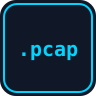

# CTF Categories

Most Jeopardy CTFs use these 8 categories. You do not need to master all. Start with Web, Crypto, and Forensics.

| | Category | Core idea |
|---|---|---|
|  | [Web Exploitation](#1-web-exploitation) | Find bugs in websites. |
|  | [Cryptography](#2-cryptography) | Break or decode secret messages. |
|  | [Digital Forensics](#3-digital-forensics) | Investigate files, logs, disks, traffic. |
|  | [Steganography](#4-steganography) | Find data hidden inside images/audio. |
|  | [Reverse Engineering](#5-reverse-engineering) | Understand a program without its source. |
|  | [Binary Exploitation (Pwn)](#6-binary-exploitation-pwn) | Abuse memory bugs in programs. |
|  | [OSINT](#7-osint) | Find answers in public information. |
|  | [General Skills / Linux](#8-general-skills--linux) | Terminal and basic tools. |

---

## 1. Web Exploitation
**Simple:** Websites have bugs. You find and use them in a lab.
**You receive:** a website URL (sometimes source code).
**You find:** a hidden page, a login bypass, leaked data.
**Example:** A login form lets you in as `admin` without the password.
**الدارجة:** تلقى غلطة فموقع باش تدخل فين ماشي مسموح ليك (غير فـ lab).

## 2. Cryptography
**Simple:** Messages are scrambled. You unscramble them.
**You receive:** a ciphertext, a script, or a server that encrypts.
**You find:** the original message or a key.
**Example:** `Y3RmX2lzX2Z1bg==` looks random, but it is Base64 text.
**الدارجة:** نص مشفر وخاصك ترجعو لأصلو.

## 3. Digital Forensics
**Simple:** Be a detective. Analyse evidence.
**You receive:** a file, a memory dump, a network capture (`.pcap`), logs.
**You find:** what happened, or a hidden flag in the evidence.
**Example:** A "picture" is actually a ZIP file with the wrong extension.
**الدارجة:** كتحقق فـ ملف باش تعرف شنو واقع.

## 4. Steganography
**Simple:** Hiding a secret *inside* something normal.
**You receive:** an image, audio file, or document.
**You find:** the hidden message inside it.
**Example:** A photo has text hidden at the end of the file.
**الدارجة:** سر مخبي داخل تصويرة ولا صوت.

## 5. Reverse Engineering
**Simple:** You get a program but not its source code. Figure out what it does.
**You receive:** an executable file.
**You find:** the secret input (password/key) it expects.
**Example:** A program asks for a password, and you discover it by reading the program.
**الدارجة:** عندك برنامج بلا الكود ديالو، خاصك تفهم كيفاش خدام.

## 6. Binary Exploitation (Pwn)
**Simple:** Programs written in C can have memory bugs. You trigger them in a lab.
**You receive:** a program and a server to connect to (`nc host port`).
**You find:** a way to make the program give you a shell or print the flag.
**Example:** Typing too many characters changes what the program does.
**الدارجة:** تستغل غلطة فالذاكرة ديال برنامج باش يعطيك الـ flag.

## 7. OSINT
**Simple:** Open Source Intelligence: using public information.
**You receive:** a photo, username, or short story.
**You find:** a place, a person's public handle, a date.
**Example:** Find the city in a photo from a sign, shadows, and landmarks.
**الدارجة:** كتقلب فالمعلومات العامة فـ الإنترنت.

## 8. General Skills / Linux
**Simple:** The base skills for everything else.
**You receive:** a terminal challenge.
**You find:** files, commands, and tricks.
**Example:** "Find the file called `flag.txt` somewhere on the machine."
**الدارجة:** الأساسيات ديال Linux والـ terminal.

**Next:** [Rules and ethics →](ctf-rules-and-ethics.md)
