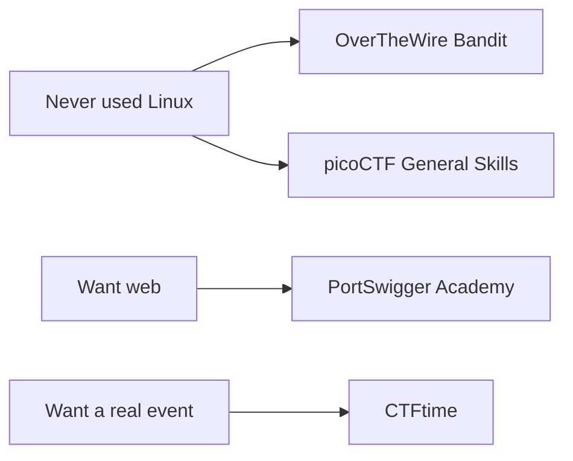

# CTF Platforms

Free and beginner-friendly first. "Account needed" means you must register (free unless stated).

| Platform | Best for | Cost | Link |
|---|---|---|---|
| **picoCTF** (Carnegie Mellon) | First CTF; all categories; hints | Free, account needed | [picoctf.org](https://picoctf.org) · [play.picoctf.org](https://play.picoctf.org) |
| **OverTheWire** | Linux terminal wargames (start with *Bandit*) | Free, no account | [overthewire.org](https://overthewire.org) |
| **PortSwigger Web Security Academy** | Web security with guided labs | Free, account needed | [portswigger.net/web-security](https://portswigger.net/web-security) |
| **Root-Me** | Many categories, French/English community | Free, account needed | [root-me.org](https://www.root-me.org) |
| **CyberDefenders** | Blue team / forensics labs | Free tier + paid | [cyberdefenders.org](https://cyberdefenders.org) |
| **CTFtime** | Calendar of real CTF events and team rankings | Free | [ctftime.org](https://ctftime.org) |
| **CTF101** | Free reading guide to CTF concepts | Free | [ctf101.org](https://ctf101.org) |

> **Link check:** picoCTF and PortSwigger pages were checked while building this repo. The others are well-known official domains; please report any broken link.

## Where should I start?

## Notes

- **picoCTF** has a year-round practice area called *picoGym*. Some flags are generated per player (dynamic), so don't copy a flag from the internet.
- **PortSwigger** labs give you a private temporary lab instance. There is no "flag": the lab is marked solved when you reach the goal.
- A *Learning platform* (like TryHackMe, Hack The Box) is also useful, but several features are paid. Check their sites for the current free options.

**Next:** [Set up your environment →](setup-your-environment.md)
