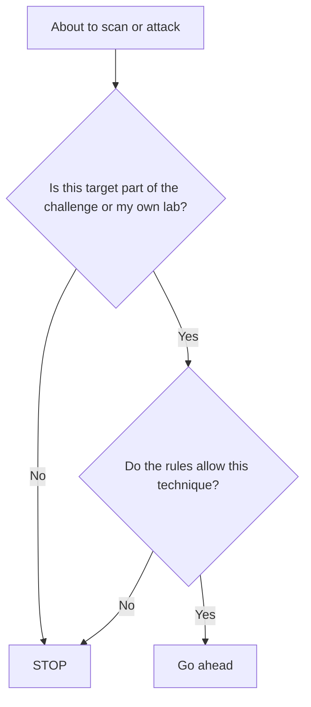

# CTF Rules and Ethics

> **STOP.** The skills you learn here can cause real harm if used on the wrong target. Read this page carefully.

## The 5 rules

1. **Authorized testing only.** Only attack systems that the organizers *gave you permission* to test.
2. **Never attack real websites or systems** (your university, banks, random sites) without written permission. This can be illegal, even if "you were just learning".
3. **Stay inside the challenge environment.** If a lab gives you one address, do not scan or attack anything else.
4. **Protect other participants.** Do not share flags, attack other players, or disturb the platform (no DoS, no spam).
5. **Respect platform rules.** Read each event's rules: team size, sharing writeups, use of AI, brute-force limits.

*بالدارجة: غير فـ الـ lab ديال التحدي. أي موقع حقيقي بلا إذن = ممنوع وقد يكون جريمة.*

## Quick check before you run any tool

## Good habits

- Keep notes of what you do (also helps you learn).
- Do not brute-force logins unless the rules allow it.
- Share writeups only after the event ends (unless the rules say otherwise).
- If you accidentally find a **real** vulnerability in a real site, do not exploit it. Report it responsibly to the owner.

## Using AI tools

Some CTFs allow AI help, some do not. Read the rules. In this repo, use AI to **understand**, not to skip the thinking.

**Next:** [How to approach a challenge →](how-to-approach-a-challenge.md)
