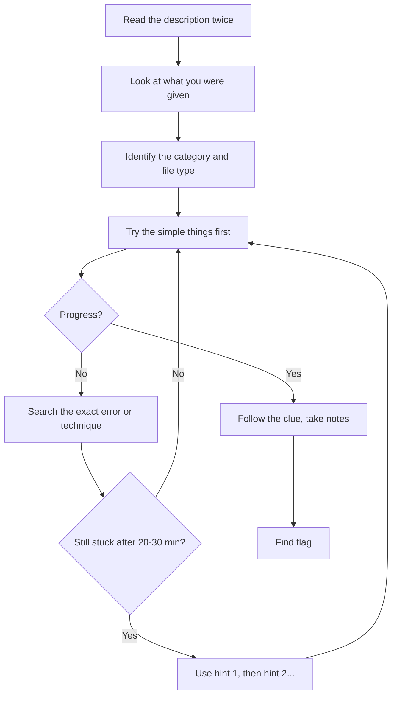

# How to Approach a CTF Challenge

Good players are not magicians. They follow a **routine**.

## The routine (copy this)

1. **Read** the title and description. Titles often contain hints.
2. **Inspect** what you got: `file`, `ls -la`, open the website, view the page source.
3. **Try simple things first.** Beginner challenges rarely need advanced tricks.
4. **Take notes:** what you tried, what happened.
5. **Search smart:** search the *technique* (e.g. "SQL injection login bypass"), not "solve challenge X".
6. **Time-box:** after 20–30 minutes stuck, use a hint.
7. **Read the writeup last,** then re-solve the challenge without looking.

## Common beginner mistakes

| Mistake | Better habit |
|---|---|
| Jumping to the writeup | Try 20–30 min first |
| Using big tools immediately | Start with `file`, `strings`, browser DevTools |
| No notes | Write every command you ran |
| Giving up after one idea | List 3 other ideas |

*بالدارجة: جرب الحاجات البسيطة الأول، ودير ملاحظات، وما تفتحش الـ writeup بسرعة.*

**Next:** [CTF platforms →](ctf-platforms.md)
