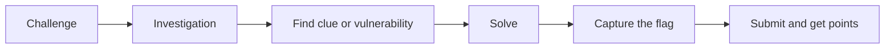

# What is CTF?

**CTF = Capture The Flag.** A cybersecurity game where you solve challenges to find a hidden text called a **flag**.

> **EN:** A flag is a hidden string that proves you solved a challenge.
> **الدارجة:** الـ Flag هو واحد الكود مخبي خاصك تلقاه باش تثبت بلي قدرت تحل التحدي.

A flag usually looks like this: `flag{some_secret_text}` or `picoCTF{...}`.

## What do participants actually do?

You get a challenge (a file, a website, a server address, or a question). You investigate, learn, and find the flag. Then you paste it into the platform to earn **points**.

## Important: not every flag means "hacking"

Finding a flag does **not** always mean breaking into something. Depending on the challenge, you may:

- decode a message,
- analyse a file (metadata, hidden text),
- investigate public information (OSINT),
- read a program's logic (reverse engineering),
- exploit a bug **inside an authorized lab** made for this purpose.

*بالدارجة: ماشي دائما كتهاك شي حاجة. بزاف ديال التحديات هي تحليل وتفكير.*

## Why do CTFs exist?

- To **learn** security skills safely and legally.
- To **practice** real techniques in a controlled lab.
- To **compete** and meet other students (and recruiters).

## How points and challenges work

| Idea | Meaning |
|---|---|
| Challenge | One task, in a category (web, crypto, ...). |
| Flag | The answer you submit. |
| Points | Harder challenge = more points. |
| Scoreboard | Ranking of players or teams. |
| Hints | Some platforms give hints (sometimes they cost points). |
| Dynamic flag | The flag is different per player, so you cannot copy someone else's. |

> Some platforms (like PortSwigger Web Security Academy) have **no flag at all**: the lab is solved when you reach a goal (for example "delete user carlos").

## Types of CTF

| Type | Description | Good for |
|---|---|---|
| **Jeopardy** | A board of independent challenges by category. | Beginners (most common) |
| **Attack-Defense** | Teams defend their own server and attack others. | Advanced teams |
| **Wargames** | Levels you unlock one by one (e.g. OverTheWire). | Learning step by step |

## Individual vs team

- **Individual:** you alone. Good for learning basics.
- **Team:** members share categories (one does web, one does crypto...). Most big CTFs are team-based.
- Check the rules: some events limit team size.

**Next:** [CTF categories →](ctf-categories.md)
