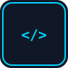
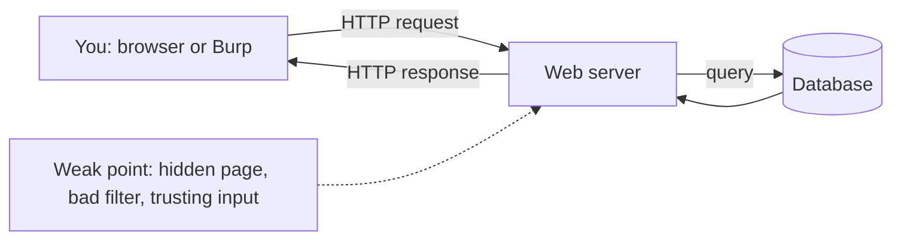
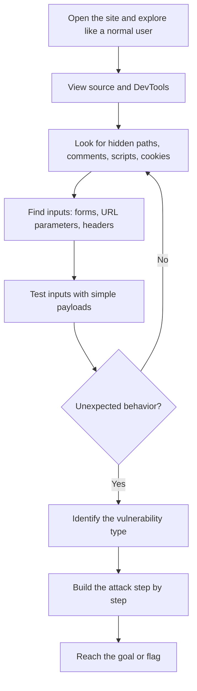
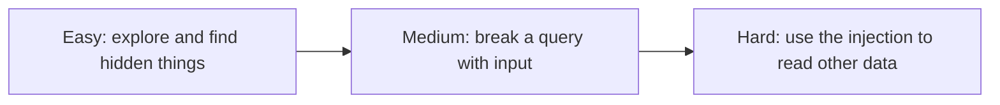

#  Web Exploitation

-48BB78)

## A. What is this category?

**Definition:** Web challenges give you a website. Somewhere in it is a weakness (a hidden page, a bad login, unsafe input). You find it and use it, **inside a lab built for this**, to reach a goal or flag.

**Analogy:** A shop with a back door. The owner locked the front door but forgot the back one. You are the inspector who finds it.

> **الدارجة:** الموقع كيشتغل بـ request و response. كنقلبو فين الموقع كيثق بزاف فـ اللي كندخلو ليه (input) ولا كيخبي حاجة بطريقة ضعيفة.

**Example challenge:** "This site has an admin panel. Delete the user `carlos`." You discover `/robots.txt`, find a path, and open it.

## B. How do we solve these challenges?

## C. Concepts to learn

See the full progressive list: **[concepts/](concepts/README.md)**.

## D. Tools and environment

See **[tools/](tools/README.md)**. Short answer: a browser with DevTools is enough for the Easy challenge and most of the Medium one. Burp Suite Community is recommended from Medium onward. Kali is **not** required; a VM is optional.

## E. Progressive challenges

All three are **PortSwigger Web Security Academy** labs. Free account required. Labs run on a temporary private instance, so there is **no fixed flag**: the lab is solved when you reach its goal.

| Level | Challenge | Platform | Link | Folder |
|---|---|---|---|---|
|  | Unprotected admin functionality | PortSwigger | [lab](https://portswigger.net/web-security/access-control/lab-unprotected-admin-functionality) | [open](challenges/easy/unprotected-admin-functionality/) |
|  | SQL injection vulnerability allowing login bypass | PortSwigger | [lab](https://portswigger.net/web-security/sql-injection/lab-login-bypass) | [open](challenges/medium/sqli-login-bypass/) |
|  | SQL injection UNION attack, retrieving data from other tables | PortSwigger | [lab](https://portswigger.net/web-security/sql-injection/union-attacks/lab-retrieve-data-from-other-tables) | [open](challenges/hard/sqli-union-retrieve-data/) |

> PortSwigger labels these *Apprentice*, *Apprentice*, and *Practitioner*. "Hard" here means "hard for a beginner", not hard in general.

### Why these three? (learning progression)

### Concept coverage table

| Concept | Easy | Medium | Hard |
|---|:---:|:---:|:---:|
| HTTP requests/URLs | ✅ | ✅ | ✅ |
| Browser DevTools / reading the page | ✅ | | |
| `robots.txt` and information disclosure | ✅ | | |
| Broken access control (no auth on admin page) | ✅ | | |
| How SQL queries are built from input | | ✅ | ✅ |
| Breaking out of a string with `'` | | ✅ | ✅ |
| SQL comments (`--`) | | ✅ | ✅ |
| Authentication logic bypass | | ✅ | |
| `UNION SELECT` | | | ✅ |
| Matching number of columns / data types | | | ✅ |
| Reading data from another table | | | ✅ |
| Modifying requests (Burp or URL) | | ✅ | ✅ |

**Not covered here (planned for later practice):** XSS, file upload, CSRF, SSRF, command injection. The folder will be extended in future work.

## F. Quality checklist

- [x] Challenge URLs found and checked against PortSwigger's own pages (Nov 2026)
- [x] Challenges belong to the category
- [x] Access requirements stated (free account, Burp Community optional/recommended)
- [x] Difficulty progression reasonable
- [x] Videos: YouTube **search links** only (no individual video verified; see concepts)
- [x] No fabricated flags (these labs have none)
- [x] Writeups match the linked labs
- [ ] ⚠️ Writeups are **source-verified**, not independently re-run by the author. Please run each lab and report any mismatch
- [x] Legal: PortSwigger labs are made for this purpose; do not attack anything else
- [ ] Screenshots: none yet (add your own when you solve the labs)

**More:** [resources.md](resources.md)
