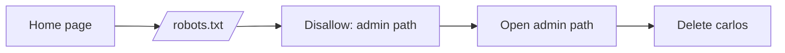

# Writeup: Unprotected admin functionality

> 🟡 **Verification status: Source-verified.**
> The steps below were checked against PortSwigger's official solution text for this lab (retrieved Nov 2026). The author of this repository did **not** re-run the lab live. If your lab behaves differently, please open an issue.
>
> ⛔ **Spoilers below.** Try the lab and the [hints](hints.md) first.

**Lab:** <https://portswigger.net/web-security/access-control/lab-unprotected-admin-functionality>
**Goal:** delete the user `carlos`.
**Flag:** none. The lab is "solved" when you reach the goal.

> **Note on lab URLs:** each lab instance has a unique address like `https://<random>.web-security-academy.net`. Below, `LAB` means *your* instance address.



## Step 1: Understand the target

- **Trying to discover:** what the site does and what we must reach.
- **Why:** the description says the admin panel is *unprotected*. That means no login is needed. We only need to **find** where it is.
- **Next:** guess where a site might reveal hidden paths.

## Step 2: Look at `robots.txt`

- **Discover:** whether the site lists "private" paths.
- **Why:** `robots.txt` is a public text file telling search engines which paths not to crawl. Developers sometimes list secret paths there. But it is public, so anyone can read it, including you.
- **Command / action:** in the browser, open
  ```
  LAB/robots.txt
  ```
  or in a terminal (replace `LAB` with your instance's address):
  ```bash
  curl -i LAB/robots.txt
  ```
- **What the output means:** according to the official solution, a `Disallow` line reveals the path to the admin panel. In this lab that path is `/administrator-panel`.
- **Next:** visit that path.

## Step 3: Open the admin panel

- **Discover:** whether the path really needs a login.
- **Why:** hiding a page is not the same as protecting it. If the server does not check who you are, anyone who knows the URL can use it. This is **broken access control**.
- **Action:** replace `/robots.txt` in the address bar with
  ```
  /administrator-panel
  ```
- **What the output means:** an admin page with a list of users appears, without any login.
- **Next:** use it.

## Step 4: Delete `carlos`

- **Action:** click *Delete* next to `carlos`.
- **Result:** the lab page changes to show it is solved (PortSwigger shows a "Congratulations, you solved the lab!" message).
- **How this leads to the goal:** the vulnerability was twofold: the path leaked in `robots.txt`, and the admin page had no access check.

## What you learned

| Idea | Lesson |
|---|---|
| `robots.txt` | Public. Never use it to hide secrets. |
| Access control | Every sensitive page must check permission on the **server**. |
| CTF habit | Always check `robots.txt`, page source, and common paths. |

*بالدارجة: الإخفاء ماشي حماية. إلا السيرفر ما كيتحققش من المستخدم، أي واحد كيعرف الرابط يدخل.*

## Related lab to try next

[Unprotected admin functionality with unpredictable URL](https://portswigger.net/web-security/access-control/lab-unprotected-admin-functionality-with-unpredictable-url). The official solution says the admin URL is disclosed in JavaScript on the home page, so view the page source.
