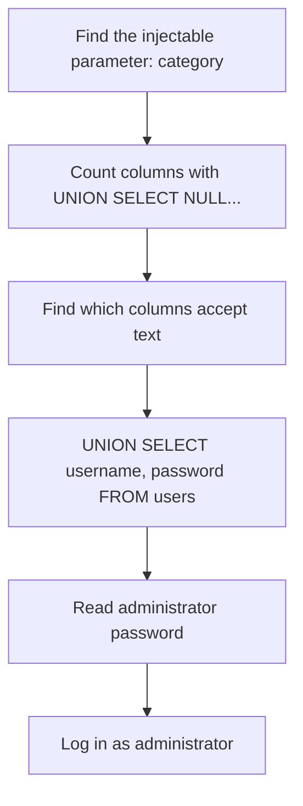

# Writeup: SQL injection UNION attack, retrieving data from other tables

> 🟡 **Verification status: Source-verified.**
> The payloads below follow PortSwigger's official solutions for this lab and its two prerequisite labs (retrieved Nov 2026). The author did **not** re-run the lab live. In particular, using the **browser URL bar** instead of Burp is expected to work because the category is a URL parameter, but it was **not tested** by the author. If it fails, use Burp.
>
> ⛔ **Spoilers below.** Try the lab and the [hints](hints.md) first.

**Lab:** <https://portswigger.net/web-security/sql-injection/union-attacks/lab-retrieve-data-from-other-tables>
**Goal:** get the administrator's password from the `users` table and log in.
**Flag:** none. The lab is solved when you log in as `administrator`.
**Passwords are random** per lab instance. This writeup never shows a real one.

> In URLs, `+` means a space. That is why PortSwigger writes payloads like `'+UNION+SELECT+NULL--`.



## Step 1: Find the injectable parameter

- **Discover:** which input reaches the database.
- **Why:** the lab says the *product category filter* is vulnerable. Choosing a category sends a request with a `category` parameter. The query is probably similar to:
  ```sql
  SELECT ... FROM products WHERE category = 'Gifts' ...
  ```
  (assumed shape; the exact query is not shown)
- **Action:** in Burp, intercept the request that filters by category (or just use the address bar). Replace the value of `category` with the payloads below.

## Step 2: Find the number of columns

- **Discover:** how many columns the original query returns.
- **Why:** `UNION` only works if both queries return the **same number of columns**. Otherwise the database returns an error.
- **Command (value of `category`):**
  ```
  '+UNION+SELECT+NULL--
  ```
  An error appears (one column is not enough). Then add one `NULL` at a time:
  ```
  '+UNION+SELECT+NULL,NULL--
  ```
- **Why `NULL`:** `NULL` is compatible with almost any data type, so it avoids type errors while we count.
- **What the output means:** when the error disappears and the page returns extra content, you found the number. For this lab, the official solution says the query returns **2 columns**.

## Step 3: Find which columns accept text

- **Discover:** where we can display text such as usernames.
- **Why:** passwords and usernames are strings. A column that expects numbers would error.
- **Command:**
  ```
  '+UNION+SELECT+'abc','def'--
  ```
- **What the output means:** if no error occurs and `abc`/`def` appear in the page, both columns accept text. The official solution says both do in this lab.

## Step 4: Dump the `users` table

- **Discover:** all usernames and passwords.
- **Why:** the lab tells us the table is `users` and the columns are `username` and `password`. Because both columns accept text, we can place them in the two positions.
- **Command:**
  ```
  '+UNION+SELECT+username,+password+FROM+users--
  ```
  The full request might look like this (replace the host with your lab instance and verify the path in your own browser):
  ```
  GET /filter?category='+UNION+SELECT+username,+password+FROM+users-- HTTP/2
  ```
- **What the output means:** the page now lists usernames and passwords mixed with the normal results. Find the row whose username is `administrator`.

> Why does it show on the page? The app prints whatever the query returns, so our extra rows show up like products.

## Step 5: Log in

- **Action:** go to *My account*, log in with username `administrator` and the password you found.
- **Result:** the lab is marked solved.

## If it didn't work

| Symptom | Possible cause |
|---|---|
| Error with every `NULL` count | Typo, or a missing comment `--` at the end |
| Works with `NULL`, fails with `'abc'` | That column is not a text column; try another position |
| Your rows are hidden among many products | Start the value with `'` (an empty category) so the original query matches nothing, or use a category name that does not exist |
| Browser URL bar changes characters | Use Burp Repeater and URL-encode spaces as `+` |

## Defense

Use **parameterized queries**, least-privileged DB accounts, and never show raw DB errors to users.

*بالدارجة: الـ UNION كيزيد نتائج ديال جدول آخر على النتائج الأصلية. خاص نفس عدد الأعمدة، وخاص عمود كيقبل النص.*

## What you learned

| Skill | Where used |
|---|---|
| Counting columns | Step 2 |
| Testing data types | Step 3 |
| Reading another table | Step 4 |
| Combining all SQLi ideas | Whole lab |

**Next ideas:** [SQL injection cheat sheet](https://portswigger.net/web-security/sql-injection/cheat-sheet), then the official labs on listing database contents.
