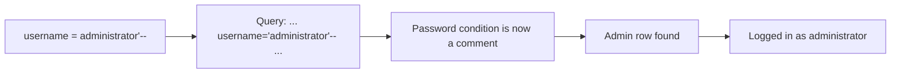

# Writeup: SQL injection vulnerability allowing login bypass

> 🟡 **Verification status: Source-verified.**
> Checked against PortSwigger's official solution text (retrieved Nov 2026), which says to set the username to `administrator'--`. The author did **not** re-run the lab live. Report any difference.
>
> ⛔ **Spoilers below.** Try the lab and the [hints](hints.md) first.

**Lab:** <https://portswigger.net/web-security/sql-injection/lab-login-bypass>
**Goal:** log in as `administrator`.
**Flag:** none. The lab is solved when you are logged in as the administrator.

## Step 1: Imagine the query behind the login

- **Trying to discover:** how the server checks your credentials.
- **Why:** SQL injection works when user input is pasted **directly** into a query. A typical (assumed, not shown by the lab) query looks like:
  ```sql
  SELECT * FROM users WHERE username = 'YOUR_USERNAME' AND password = 'YOUR_PASSWORD'
  ```
  If a row is found, you are logged in.
- **Next:** see if our input can change the query.

## Step 2: Test with a single quote

- **Action:** open *My account*, type `'` in the username and anything in the password, submit.
- **Why:** the quote closes the username string early. If the app is vulnerable, this can cause an error or odd behavior, because the query becomes invalid. (Not every app shows an error. Some just fail login.)
- **What the output means:** an error or different behavior from a normal wrong password suggests our input reaches the SQL query. Treat this as a clue, not proof.
- **Next:** craft a username that keeps the query valid and removes the password check.

## Step 3: Comment out the password check

- **Action:** username:
  ```
  administrator'--
  ```
  Password: anything (for example `x`).
- **Why this works:** the query becomes
  ```sql
  SELECT * FROM users WHERE username = 'administrator'--' AND password = 'x'
  ```
  - `'` after `administrator` closes the username string.
  - `--` starts a SQL comment. The database ignores `' AND password = 'x'`.
  - The remaining query asks only "is there a user called `administrator`?". The answer is yes.
- **Where to type it:** directly in the login form in the browser should work. The official solution uses Burp: intercept the login request and change the `username` parameter to this value. Both do the same thing.
- **Result:** you are logged in as `administrator`, and the lab is marked solved.



## Technical notes

| Topic | Note |
|---|---|
| `--` spacing | Some databases (for example MySQL) need a space after `--`, so people write `-- -`. Other writeups use `administrator'-- -` or `administrator' OR 1=1-- -`. The official solution for this lab uses `administrator'--`. |
| Other approach | `' OR 1=1--` can also work in many labs, but logging in as the *specific* user `administrator` is cleaner. |
| Defense | Use **parameterized queries** (prepared statements). Never build SQL by joining strings with user input. |

*بالدارجة: الـ `'` كيسد النص، والـ `--` كيخلي الباقي تعليق، والسيرفر ما كيتحققش من الباسورد.*

## What you learned

- How input becomes part of SQL.
- How to break out of a string and comment out the rest.
- Why parameterized queries stop this.

**Next:** [Hard challenge →](../../hard/sqli-union-retrieve-data/README.md)
