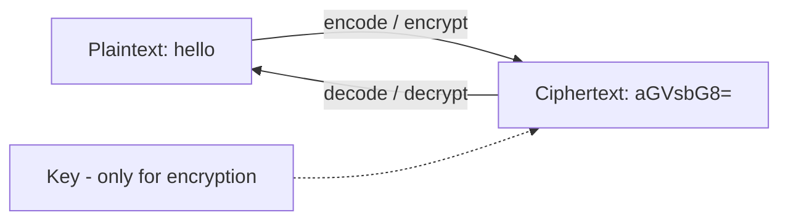
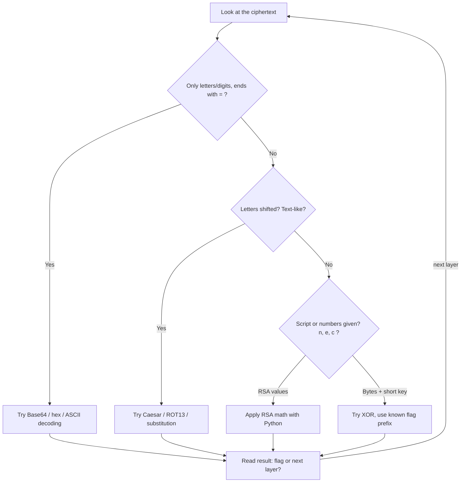
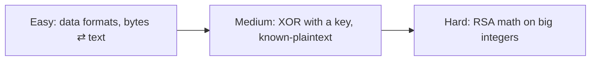

#  Cryptography

-48BB78)

## A. What is this category?

**Definition:** Crypto challenges give you a scrambled message (or a program that scrambles messages). You find the method and recover the original text, the key, or the flag.

**Analogy:** A letter written in a secret code. Sometimes the "code" is just a different alphabet (encoding). Sometimes it needs a key (encryption). Your job is to find which one, then reverse it.

> **الدارجة:** عندك نص مخلط. خاصك تعرف واش غير ترميز (encoding، بلا مفتاح) ولا تشفير (encryption، بالمفتاح)، ومن بعد ترجعو للأصل ديالو.

**Encoding vs encryption vs hashing** (the most important idea of this category):

| | Needs a key? | Reversible? | Example |
|---|---|---|---|
| **Encoding** | No | Yes, by anyone | Base64, hex, ASCII |
| **Encryption** | Yes | Yes, with the key | XOR, AES, RSA |
| **Hashing** | No | No (one-way) | SHA-256, MD5 |

*بالدارجة: الترميز ماشي سر. التشفير خاصو مفتاح. الـ hash ما كيرجعش.*

## B. How do we solve these challenges?

**The routine:**

1. **Identify** the format (charset, length, `=` padding, numbers).
2. **Try encodings first.** They are the most common "easy" layer.
3. **Use the known flag format** (`crypto{`, `picoCTF{`). It is a free piece of plaintext.
4. **Write a small Python script** once the method is clear.
5. **Repeat:** many challenges stack several layers.

## C. Concepts to learn

See the full progressive list: **[concepts/](concepts/README.md)**.

## D. Tools and environment

See **[tools/](tools/README.md)**. Short answer: **a browser (CyberChef) + Python 3** is enough for all three challenges. Kali is **not** required.

## E. Progressive challenges

All three are from **CryptoHack** (free account needed to submit flags). Flags are **static** and use the format `crypto{...}`. This repo never prints them: you must find them yourself.

| Level | Challenge | Platform | Link | Folder |
|---|---|---|---|---|
|  | Encoding: ASCII, Hex, Base64 | CryptoHack | [General](https://cryptohack.org/challenges/general/) | [open](challenges/easy/encoding-bases/) |
|  | XOR: XOR Starter → Favourite byte | CryptoHack | [General](https://cryptohack.org/challenges/general/) | [open](challenges/medium/xor-single-byte/) |
|  | RSA Starter (exponentiation → decryption) | CryptoHack | [RSA](https://cryptohack.org/challenges/rsa/) | [open](challenges/hard/rsa-starter/) |

> The Easy and Medium challenges are part of the official free course [Introduction to CryptoHack](https://cryptohack.org/courses/intro/).

### Why these three? (learning progression)

- **Easy** teaches how text, bytes, hex, Base64, and big integers are the same data in different shapes.
- **Medium** reuses bytes/hex and adds a **key** (XOR) and the trick of using the known flag prefix.
- **Hard** reuses "bytes ⇄ big integer" and adds **modular arithmetic** and **public-key** crypto.

### Concept coverage table

| Concept | Easy | Medium | Hard |
|---|:---:|:---:|:---:|
| ASCII / characters as numbers | ✅ | ✅ | ✅ |
| Hex encoding | ✅ | ✅ | |
| Base64 encoding | ✅ | | |
| Bytes ⇄ big integers | ✅ | | ✅ |
| Python for crypto (`bytes`, `pow`) | ✅ | ✅ | ✅ |
| XOR operation and its properties | | ✅ | |
| Brute-forcing a small key space | | ✅ | |
| Known-plaintext (flag prefix) | | ✅ | |
| Modular arithmetic | | | ✅ |
| RSA keys (n, e, d, φ) | | | ✅ |
| Modular inverse | | | ✅ |

**Not covered here (next steps):** Vigenère and frequency analysis, AES modes (ECB/CBC), hash attacks, small-exponent RSA attacks. CryptoHack has a course for each.

> **Classic ciphers?** Caesar/ROT13 are covered in the concepts page with a free extra practice: picoCTF *Mod 26* (picoGym, Cryptography).

## F. Quality checklist

- [x] Challenge pages exist and were checked (CryptoHack course + category pages, Nov 2026)
- [x] Challenges belong to Cryptography; progression Easy → Hard is logical
- [x] Access stated (free CryptoHack account to submit)
- [x] Static flags, **not reproduced** here
- [x] Videos: YouTube **search links** (see concepts)
- [ ] ⚠️ Writeups are **source-verified** (method checked against the public challenge statements and well-known solutions), not re-run live by the repo author

**More:** [resources.md](resources.md)
