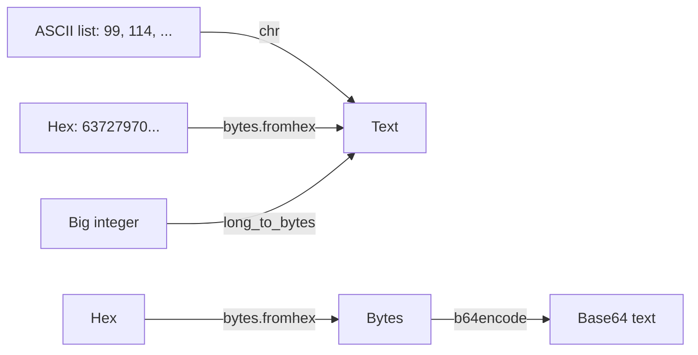

# Writeup: Encoding (ASCII, Hex, Base64, Bytes and Big Integers)

> 🟡 **Verification status: Source-verified.**
> Methods checked against the public CryptoHack statements (Nov 2026). Code was tested on **example values**, not on the real challenge data. Flags are **not** shown: run the code on the data from your challenge page.
>
> ⛔ **Spoilers below.** Try the challenge and the [hints](hints.md) first.

**Page:** <https://cryptohack.org/challenges/general/>
**Goal:** convert each given value into readable text `crypto{...}`.



## Part 1: ASCII

- **What we look for:** text hidden as a list of numbers.
- **Clue:** all numbers are between 32 and 126. That is the printable ASCII range.
- **Tool:** Python's `chr()` converts a number to its character.
- **Command (example values):**
  ```python
  nums = [72, 105]
  print("".join(chr(n) for n in nums))   # Hi
  ```
- **Interpretation:** paste the list from the challenge into `nums`. The output starts with `crypto{`: that is the flag.

## Part 2: Hex

- **What we look for:** text written in base 16.
- **Clue:** only characters `0-9a-f`, and an even length (2 digits per byte).
- **Tool:** `bytes.fromhex()`.
- **Command (example):**
  ```python
  print(bytes.fromhex("4869"))           # b'Hi'
  ```
- **Interpretation:** the result is a `bytes` object (`b'...'`). If it is readable and starts with `crypto{`, you are done.

## Part 3: Base64

- **What we look for:** the statement gives **hex** and asks for the **Base64** form.
- **Why two steps:** Base64 works on **bytes**, not on the hex text. Encoding the hex characters directly gives a wrong answer.
- **Command (example):**
  ```python
  import base64
  raw = bytes.fromhex("4869")            # step 1: hex -> bytes  (b'Hi')
  print(base64.b64encode(raw))           # step 2: bytes -> Base64  b'SGk='
  ```
- **Interpretation:** the Base64 output itself is the flag text here.
- **CyberChef alternative:** Recipe *From Hex* → *To Base64*.

## Part 4: Bytes and Big Integers

- **What we look for:** text stored as **one huge number**.
- **Why it works:** a message of bytes `b1 b2 b3...` can be read as a number in base 256. RSA (our Hard challenge) uses exactly this.
- **Command (example):**
  ```python
  from Crypto.Util.number import long_to_bytes   # pip install pycryptodome
  print(long_to_bytes(18537))                    # b'Hi'
  # Without PyCryptodome:
  n = 18537
  print(n.to_bytes((n.bit_length() + 7) // 8, "big"))   # b'Hi'
  ```
- **Interpretation:** a readable `crypto{...}` string means the conversion is right.

## What you learned

| Idea | Lesson |
|---|---|
| ASCII | Characters are numbers |
| Hex | 2 hex digits = 1 byte |
| Base64 | Encodes **bytes**; decode hex first |
| Big integers | Text can become one number (used by RSA) |

*بالدارجة: نفس البيانات تقدر تكون نص، hex، Base64، ولا رقم كبير. خاصك غير تعرف كيفاش تحول بيناتهم.*

**Next:** [Medium challenge →](../../medium/xor-single-byte/README.md)
