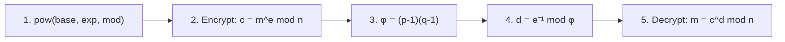

# Writeup: RSA Starter

> 🟡 **Verification status: Source-verified.**
> Method checked against the public CryptoHack statements (Nov 2026). All code below runs on the **textbook example** `p = 61, q = 53, e = 17` (outputs checked with Python 3). Use the values from **your** challenge page to get the real answers. Answers and flags are **not** shown.
>
> ⛔ **Spoilers below.** Try the challenge and the [hints](hints.md) first.

**Page:** <https://cryptohack.org/challenges/rsa/>
**Goal:** understand and compute every piece of RSA, then decrypt.



## Step 1: Modular Exponentiation

- **What we look for:** `base^exp mod n` for big numbers.
- **Why not `base**exp % n`?** It computes a gigantic number first. That is slow or impossible for real RSA sizes. `pow(base, exp, n)` reduces at every step (fast).
- **Command:**
  ```python
  print(pow(4, 13, 497))      # 445
  ```
- **Interpretation:** use the base, exponent, and modulus from the statement. The number printed is the answer.

## Step 2: Public Keys (encrypt)

- **What we look for:** the ciphertext `c` of a small message `m`.
- **Why:** the public key is `(n, e)`. Anyone can encrypt with it.
- **Command (example):**
  ```python
  p, q, e, m = 61, 53, 17, 65
  n = p * q                   # 3233
  c = pow(m, e, n)
  print(c)                    # 2790
  ```

## Step 3: Euler's Totient

- **What we look for:** `φ(n)`, the number of integers below `n` that share no factor with `n`.
- **Why:** it links `e` and `d`. For `n = p × q` with primes `p, q`:
  ```python
  phi = (p - 1) * (q - 1)
  print(phi)                  # 3120
  ```
- **Security note:** computing `φ` requires `p` and `q`. That is why RSA is safe only if `n` is too big to factor.

## Step 4: Private Keys

- **What we look for:** `d`, the private exponent.
- **Why:** `d` is the **modular inverse** of `e`: `e × d ≡ 1 (mod φ)`.
- **Command:**
  ```python
  d = pow(e, -1, phi)          # Python 3.8+
  print(d)                     # 2753
  print((e * d) % phi)         # 1  -> check passed
  ```
- **Interpretation:** the check line printing `1` proves `d` is correct.

## Step 5: RSA Decryption

- **What we look for:** the original message `m` from `c`.
- **Command:**
  ```python
  m = pow(c, d, n)
  print(m)                     # 65  -> our original message
  ```
- **For the CryptoHack task:** use the challenge's `c` and the `d` from Step 4 (same parameters). If the result is a number that should be text, convert it with `long_to_bytes(m)` (from the Easy challenge). The statement tells you what to submit.

## Full example in one block

```python
p, q, e = 61, 53, 17
n, phi = p * q, (p - 1) * (q - 1)
d = pow(e, -1, phi)
m = 65
c = pow(m, e, n)
assert pow(c, d, n) == m
print(n, phi, d, c)          # 3233 3120 2753 2790
```

## If it didn't work

| Symptom | Fix |
|---|---|
| `ValueError: base is not invertible` | `e` and `φ` share a factor; recheck `p`, `q`, `e` |
| `pow` with `-1` fails | Python older than 3.8; use `Crypto.Util.number.inverse(e, phi)` |
| Answer rejected | You used `n` instead of `φ` for the inverse (common mistake) |

*بالدارجة: RSA كيعتمد على أن تفكيك n صعيب بزاف. المفتاح الخاص d كنحسبوه بـ φ، والـ φ ما كنعرفوهش بلا p و q.*

## What you learned

| Skill | Step |
|---|---|
| Fast modular power | 1 |
| Public-key encryption | 2 |
| Why factoring protects RSA | 3 |
| Modular inverse | 4 |
| Full encrypt/decrypt cycle | 5 |

**Going further:** CryptoHack *Factoring* and *Inferius Prime* (what happens when `n` is small enough to factor).
