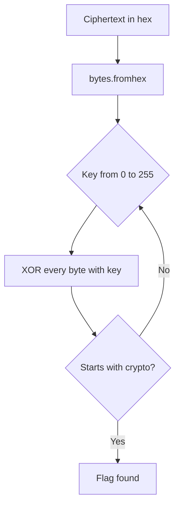

# Writeup: XOR (XOR Starter → XOR Properties → Favourite byte)

> 🟡 **Verification status: Source-verified.**
> Method checked against the public CryptoHack statements (Nov 2026). The script was tested on a **message we encrypted ourselves**, not on the real challenge data. Flags are **not** shown.
>
> ⛔ **Spoilers below.** Try the challenge and the [hints](hints.md) first.

**Page:** <https://cryptohack.org/challenges/general/>
**Goal:** recover a message XORed with an unknown single byte.



## Step 1: XOR Starter (warm-up)

- **What we look for:** the result of XORing each character of a word with a small integer.
- **Why:** this shows XOR works **byte by byte**.
- **Command (example: word `Hi`, number `32`):**
  ```python
  word, k = "Hi", 32
  print("".join(chr(ord(c) ^ k) for c in word))   # hI
  ```
- **Interpretation:** use the word and number from the statement, and wrap the result as the statement asks (`crypto{...}`).

## Step 2: XOR Properties

- **What we look for:** several keys combined together, and the flag hidden under all of them.
- **Why the properties help:** XOR is **commutative**, **associative**, `A ⊕ A = 0`, `A ⊕ 0 = A`. So you can "cancel" any key you know by XORing it again.
- **Idea:**
  ```
  KEY2 = (KEY2 ⊕ KEY1) ⊕ KEY1
  FLAG = (FLAG ⊕ KEY1 ⊕ KEY3 ⊕ KEY2) ⊕ KEY1 ⊕ KEY3 ⊕ KEY2
  ```
- **Command pattern:**
  ```python
  def xor(a, b):
      return bytes(x ^ y for x, y in zip(a, b))
  # k1 = bytes.fromhex("...") etc. -- use the values from the statement
  ```

## Step 3: Favourite byte (main challenge)

- **What we look for:** a single secret byte `k`. Every byte of the flag was XORed with the same `k`.
- **Clue:** the flag format `crypto{` is known. That is **known plaintext**.
- **Tool choice:** a 10-line Python script. Brute force is fine: only 256 keys.

**Brute-force version:**

```python
ct = bytes.fromhex("PASTE_THE_HEX_FROM_THE_CHALLENGE")
for k in range(256):
    pt = bytes(b ^ k for b in ct)
    if pt.startswith(b"crypto{"):
        print(k, pt)
```

**Smarter version (known plaintext):**

```python
k = ct[0] ^ ord("c")          # first plaintext byte must be 'c'
print(bytes(b ^ k for b in ct))
```

- **Why the smart version works:** `ct[0] = 'c' ⊕ k`, so `k = ct[0] ⊕ 'c'`.
- **What the output means:** one line, the key number and a readable `crypto{...}`. That text is the flag.

### Self-test (so you trust the script)

We encrypted our own message and recovered it:

```python
>>> msg = b"crypto{test_message}"
>>> ct = bytes(b ^ 0x5a for b in msg)
>>> k = ct[0] ^ ord("c"); k
90
>>> bytes(b ^ k for b in ct)
b'crypto{test_message}'
```

`90 = 0x5a`, the key we used. The method works.

## Why this is weak crypto

| Weakness | Consequence |
|---|---|
| Key is 1 byte | Only 256 tries |
| Same key for every byte | One known character reveals the key |
| Known format (`crypto{`) | Free known plaintext |

Real systems use long random keys (and AES), never a single repeated byte.

*بالدارجة: المفتاح ديال بايت واحد عندو غير 256 احتمال، وكنعرفو البداية ديال الـ flag، إذن كنلقاو المفتاح دغيا.*

## What you learned

- XOR works byte by byte and is its own inverse.
- Brute force is realistic when the key space is small.
- The flag format is a powerful known-plaintext clue.

**Next:** [Hard challenge →](../../hard/rsa-starter/README.md) · **Going further:** CryptoHack *You either know, XOR you don't* (multi-byte key, same known-plaintext idea).
