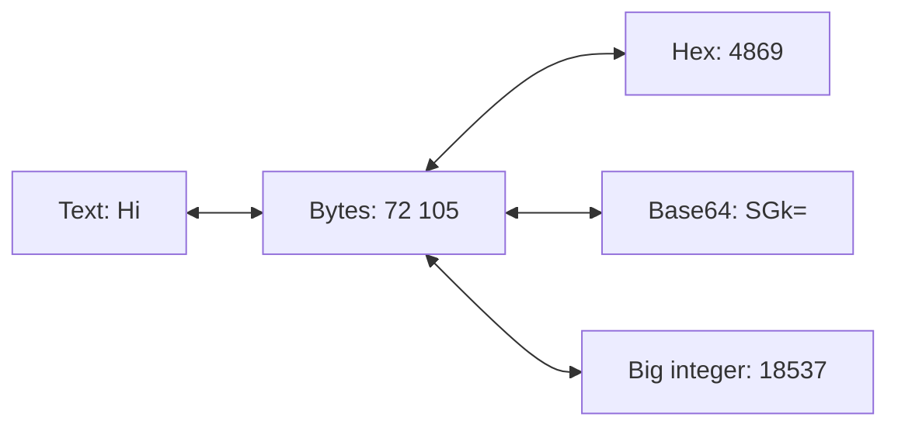
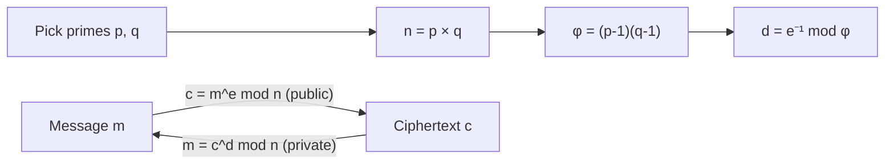

# Crypto Concepts (in order)

Learn them top to bottom. Video links are **YouTube search links** for the exact topic (no single video was verified, so none are invented). Pick a short result (3–12 min).

| # | Concept | One sentence | Why it matters in CTF | Prerequisite | Video (search) |
|---|---|---|---|---|---|
| 1 | **Bits, bytes, ASCII** | A byte is 8 bits; ASCII maps numbers 0–127 to characters (`65` = `A`). | Every crypto challenge works on bytes. | None | [search](https://www.youtube.com/results?search_query=ASCII+bits+bytes+explained+beginners) |
| 2 | **Hexadecimal** | Base 16: each byte is written as 2 hex digits (`41` = `A`). | Ciphertexts and keys are often given in hex. | 1 | [search](https://www.youtube.com/results?search_query=hexadecimal+explained+beginners) |
| 3 | **Base64** | Turns bytes into 64 safe characters; often ends with `=`. | The most common "first layer". | 1, 2 | [search](https://www.youtube.com/results?search_query=base64+encoding+explained) |
| 4 | **Encoding vs encryption vs hashing** | Encoding has no key; encryption needs a key; hashing is one-way. | Tells you which tool to try. | 3 | [search](https://www.youtube.com/results?search_query=encoding+vs+encryption+vs+hashing) |
| 5 | **Caesar / ROT13** | Shift every letter by a fixed number (ROT13 = shift 13). | Classic beginner challenge. | 1 | [search](https://www.youtube.com/results?search_query=caesar+cipher+explained) |
| 6 | **Python for crypto** | `bytes.fromhex()`, `base64`, `int.from_bytes()`, `pow()`. | You will script most solutions. | 1–3 | [search](https://www.youtube.com/results?search_query=python+bytes+hex+base64+tutorial) |
| 7 | **XOR** | Bitwise: same bits → 0, different → 1. `A ^ K ^ K = A`. | Core of symmetric crypto. | 1, 2 | [search](https://www.youtube.com/results?search_query=XOR+cipher+explained) |
| 8 | **Known-plaintext idea** | If you know part of the message (`crypto{`), you can recover the key. | Breaks weak XOR quickly. | 7 | [search](https://www.youtube.com/results?search_query=known+plaintext+attack+xor+explained) |
| 9 | **Modular arithmetic** | Clock math: `17 mod 5 = 2`. | RSA is built on it. | None | [search](https://www.youtube.com/results?search_query=modular+arithmetic+explained+beginners) |
| 10 | **RSA basics** | Public `(n, e)`, private `d`; `c = m^e mod n`, `m = c^d mod n`. | Most famous public-key system. | 9 | [search](https://www.youtube.com/results?search_query=RSA+algorithm+explained+simply) |
| 11 | **Euler's totient & modular inverse** | `φ(n) = (p-1)(q-1)`; `d = e⁻¹ mod φ(n)`. | Needed to compute the private key. | 9, 10 | [search](https://www.youtube.com/results?search_query=RSA+euler+totient+modular+inverse+explained) |

> **الدارجة:** بدا بالـ bytes والـ hex والـ Base64، من بعد الـ XOR، وفالأخير الرياضيات ديال RSA. كلشي كيبني على اللي قبل منو.

## Visual: the same data in 4 shapes

`18537 = 0x4869` = the bytes `H` `i`. This "bytes ⇄ integer" step is how RSA encrypts text.

## Visual: XOR in one table

| A | B | A ⊕ B |
|:-:|:-:|:-:|
| 0 | 0 | 0 |
| 0 | 1 | 1 |
| 1 | 0 | 1 |
| 1 | 1 | 0 |

Properties to remember: `A ⊕ 0 = A`, `A ⊕ A = 0`, so `(M ⊕ K) ⊕ K = M`.

*بالدارجة: إلا درتي XOR بنفس المفتاح جوج مرات، كترجع للنص الأصلي.*

## Visual: RSA in one picture

## Challenge → concept map

| Challenge | Needs concepts |
|---|---|
| Easy: Encoding (ASCII, Hex, Base64) | 1–4, 6 |
| Medium: XOR (Starter → Favourite byte) | 1, 2, 6–8 |
| Hard: RSA Starter | 1, 6, 9–11 |

## Extra practice (optional)

- picoCTF **Mod 26** (picoGym → Cryptography): ROT13 warm-up. Free account. <https://play.picoctf.org/practice>
- CryptoHack [Introduction course](https://cryptohack.org/courses/intro/) (free).
