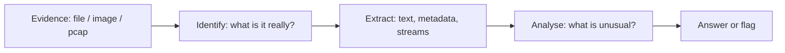
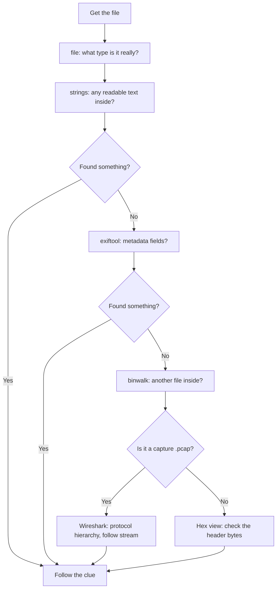
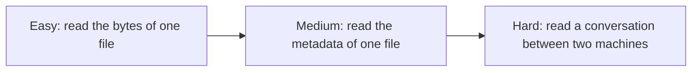

#  Digital Forensics

-48BB78)

## A. What is this category?

**Definition:** You receive **evidence**: a file, an image, a disk copy, or a network capture. You investigate it to find what is hidden inside or what happened.

**Analogy:** A detective in a room. The painting on the wall looks normal, but there is a note taped behind it. The detective checks behind everything, not only what is visible.



> **الدارجة:** كتعطاك دليل (ملف، تصويرة، ترافيك ديال الشبكة). خاصك تحقق فيه بحال المحقق: شنو هو بصح، وشنو مخبي فيه.

**Key idea:** a file is just **bytes**. A picture viewer shows you only the part it understands. Extra data can sit before, after, or beside the image, and you will never see it by looking at the picture.

## B. How do we solve these challenges?



**The routine (always the same four commands first):**

```bash
file evidence            # 1. real type, ignoring the extension
strings evidence | less  # 2. readable text inside
exiftool evidence        # 3. metadata fields
binwalk evidence         # 4. files hidden inside
```

*بالدارجة: دير هاد 4 أوامر الأول. بزاف ديال التحديات كتحل بـ `strings` ولا `exiftool` وصافي.*

## C. Concepts to learn

See the full progressive list: **[concepts/](concepts/README.md)**.

## D. Tools and environment

See **[tools/](tools/README.md)**. Short answer: **Ubuntu or WSL2 + `strings`, `exiftool`, `binwalk`, Wireshark** is enough. Kali is **not** required (it just has these preinstalled).

## E. Progressive challenges

All three are **picoCTF picoGym** challenges, Forensics category. Free account needed. Flags are **static**, format `picoCTF{...}`, and this repo never prints them.

| Level | Challenge | Platform | Link | Folder |
|---|---|---|---|---|
|  | Glory of the Garden | picoCTF | [picoGym](https://play.picoctf.org/practice?category=4) | [open](challenges/easy/strings-in-image/) |
|  | So Meta | picoCTF | [picoGym](https://play.picoctf.org/practice?category=4) | [open](challenges/medium/metadata-exiftool/) |
|  | Wireshark doo dooo do doo | picoCTF | [picoGym](https://play.picoctf.org/practice?category=4) | [open](challenges/hard/pcap-wireshark/) |

> **About the links and points:** picoGym challenges live behind a login, so there is no public per-challenge URL. Open the Forensics category and search the challenge name. picoCTF's own point values (50, 150, 50) do **not** match our Easy/Medium/Hard: our order is by **how much you need to know**, not by their score.

### Why these three? (learning progression)



- **Easy** teaches that a file holds more than what it displays, and that `strings` is your first reflex.
- **Medium** reuses that reflex, then adds a **structured** place to look: metadata fields.
- **Hard** keeps the same investigation habit but on a **network capture**, and ends with a cipher from the Cryptography category (concepts cross over).

### Concept coverage table

| Concept | Easy | Medium | Hard |
|---|:---:|:---:|:---:|
| A file is bytes, not what you see | ✅ | ✅ | ✅ |
| `file` and magic bytes | ✅ | ✅ | |
| `strings` and `grep` | ✅ | ✅ | ✅ |
| Appended data (after the real file) | ✅ | | |
| Hex view of a file | ✅ | | |
| Metadata and `exiftool` | | ✅ | |
| Packet capture (`.pcap` / `.pcapng`) | | | ✅ |
| Wireshark: protocol hierarchy | | | ✅ |
| Wireshark: follow a TCP stream | | | ✅ |
| Recognising an encoded flag (ROT13) | | | ✅ |

**Not covered here (next steps):** disk images (Sleuthkit, Autopsy), memory dumps (Volatility), file carving on corrupted files. picoGym has challenges for each.

## F. Quality checklist

- [x] Challenge names and categories checked against picoGym challenge lists and public writeups (Nov 2026)
- [x] Challenges belong to Forensics; progression Easy → Hard is logical
- [x] Access stated (free picoCTF account; challenges are behind a login)
- [x] Static flags, **not reproduced** here
- [x] Videos: YouTube **search links** (see concepts)
- [x] Commands in the writeups are standard and were run locally on our own test files
- [ ] ⚠️ Writeups are **source-verified**: the method matches the public challenge statements and known solutions, but the repo author did not re-download each challenge file

**More:** [resources.md](resources.md)
