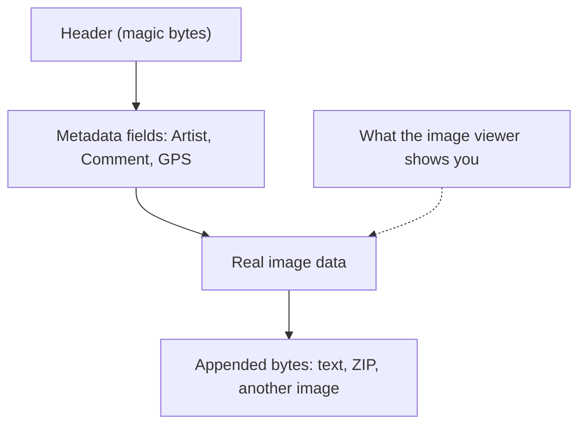

# Forensics Concepts (in order)

Learn them top to bottom. Video links are **YouTube search links** for the exact topic (no single video was verified, so none are invented). Pick a short result (3–12 min).

| # | Concept | One sentence | Why it matters in CTF | Prerequisite | Video (search) |
|---|---|---|---|---|---|
| 1 | **A file is bytes** | Any file is a long list of bytes; the extension is only a label. | Explains why hidden data is possible. | None | [search](https://www.youtube.com/results?search_query=how+files+are+stored+bytes+explained) |
| 2 | **Magic bytes / file signatures** | The first bytes say the real type (`PNG` starts `89 50 4E 47`). | `file` uses them; a wrong extension cannot hide the truth. | 1 | [search](https://www.youtube.com/results?search_query=file+signature+magic+bytes+explained) |
| 3 | **`strings`** | Prints readable text found inside a binary file. | Solves a surprising number of easy challenges. | 1 | [search](https://www.youtube.com/results?search_query=linux+strings+command+tutorial) |
| 4 | **Appended data** | Extra bytes added *after* the real file still open normally. | A classic hiding place. | 1, 3 | [search](https://www.youtube.com/results?search_query=hide+data+at+end+of+image+file+ctf) |
| 5 | **Hex view** | Shows every byte as hex plus its ASCII, side by side. | Lets you see structure that `strings` misses. | 1, 2 | [search](https://www.youtube.com/results?search_query=hex+editor+basics+tutorial) |
| 6 | **Metadata / EXIF** | Fields stored beside the image: author, date, camera, comments. | Authors love hiding flags in `Artist` or `Comment`. | 1 | [search](https://www.youtube.com/results?search_query=exiftool+metadata+tutorial) |
| 7 | **Embedded files** | A whole ZIP or image can sit inside another file. | `binwalk` finds and extracts them. | 2, 4 | [search](https://www.youtube.com/results?search_query=binwalk+tutorial+extract+files) |
| 8 | **Packets and protocols** | Network traffic is a list of packets; HTTP, DNS, TCP are protocols. | Needed before opening any capture. | None | [search](https://www.youtube.com/results?search_query=TCP+IP+packets+explained+beginners) |
| 9 | **Packet captures (`.pcap`, `.pcapng`)** | A recorded copy of network traffic. | The file type of every network challenge. | 8 | [search](https://www.youtube.com/results?search_query=what+is+a+pcap+file+explained) |
| 10 | **Wireshark basics** | Open a capture, filter it, and read one conversation. | The standard tool. | 9 | [search](https://www.youtube.com/results?search_query=wireshark+tutorial+for+beginners) |
| 11 | **Follow a stream** | Reassembles one TCP conversation into readable text. | Where plaintext flags appear. | 10 | [search](https://www.youtube.com/results?search_query=wireshark+follow+tcp+stream+tutorial) |

> **الدارجة:** بدا بفهم أن الملف هو bytes، من بعد الأدوات (`strings`, `exiftool`, `binwalk`)، وفالأخير الشبكة مع Wireshark.

## Visual: where data can hide in one file

The viewer renders only the image data. Everything else is invisible to your eyes but visible to your tools.

## Visual: which tool for which hiding place

| Hiding place | Tool that finds it |
|---|---|
| Readable text anywhere | `strings` |
| Metadata field | `exiftool` |
| Another file inside | `binwalk` |
| Wrong or forged header | `file`, hex view |
| Inside network traffic | Wireshark |

## Important: file size is a free clue

A 2 MB photo of a plain garden is suspicious. Compare the size you expect with the size you got. A big difference means something extra is inside.

*بالدارجة: إلا كان حجم الملف كبير بزاف على اللي كتشوف، يعني كاين شي حاجة زايدة فيه.*

## Challenge → concept map

| Challenge | Needs concepts |
|---|---|
| Easy: Glory of the Garden | 1–5 |
| Medium: So Meta | 1–3, 6 |
| Hard: Wireshark doo dooo do doo | 8–11 (+ ROT13 from [Cryptography](../../03-cryptography/concepts/README.md)) |

## Extra practice (optional, free)

- picoGym Forensics: **extensions** (wrong file type), **Matryoshka doll** (nested files, needs `binwalk`), **Packets Primer** (first Wireshark steps).
