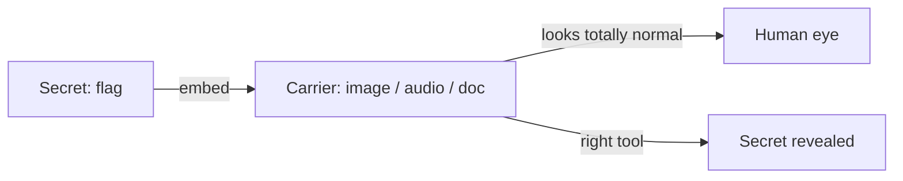
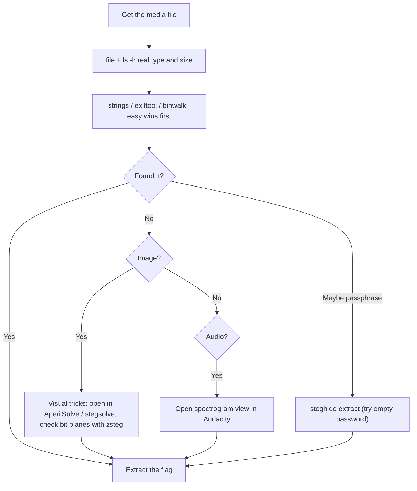
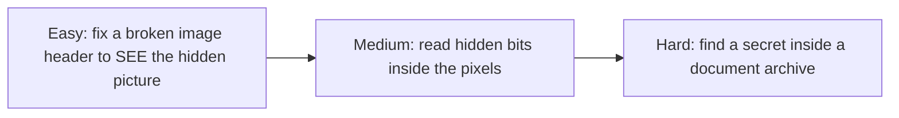

#  Steganography

-48BB78)

## A. What is this category?

**Definition:** Steganography hides a secret **inside** a normal-looking file (an image, an audio clip, a document). Your job is to find and extract it.

**Analogy:** invisible ink on an ordinary letter. The letter reads normally; the secret only shows under the right lamp. Your tools are that lamp.

> **الدارجة:** الـ steganography هي تخبئة سر **داخل** ملف عادي (تصويرة، صوت، مستند). التحدي هو تلقاه وتخرجو.

**Stego vs Forensics:** they overlap. Forensics is "investigate the evidence"; stego is specifically "a secret was *deliberately hidden* inside media". Many platforms (including picoCTF) file stego under Forensics. The tools differ: here you work on **pixels and sound**, not just file bytes.

**Stego vs Cryptography:** crypto makes a message **unreadable** (you see it, but it is scrambled). Stego makes a message **unseen** (you do not even know it is there). CTFs often combine both: hide an encoded message, then make you find *and* decode it.

## B. How do we solve these challenges?

**The routine:**

1. **Always run the forensics four first** (`file`, `strings`, `exiftool`, `binwalk`). Many "stego" flags are just appended data or metadata.
2. **If it is an image and that failed:** think *pixels*. Bit planes (`zsteg`), channels, and visual tools (`Aperi'Solve`, `stegsolve`).
3. **If it is audio:** think *spectrogram* (Audacity). Flags are often drawn as text in the frequencies.
4. **If a passphrase tool fits:** try `steghide` (often with an **empty** password).

*بالدارجة: بدا ديما بـ `strings` و `exiftool` و `binwalk`. إلا ما لقيتي والو، ودخّل راسك فالـ pixels (zsteg) ولا الصوت (spectrogram).*

## C. Concepts to learn

See the full progressive list: **[concepts/](concepts/README.md)**.

## D. Tools and environment

See **[tools/](tools/README.md)**. Short answer: **a browser (Aperi'Solve) covers a lot**; add `zsteg`, `steghide`, and Audacity for the rest. Kali is **not** required.

## E. Progressive challenges

All three are **picoCTF picoGym** challenges (filed under Forensics). Free account. Static flags, format `picoCTF{...}`, **not** printed here.

| Level | Challenge | Platform | Link | Folder |
|---|---|---|---|---|
|  | tunn3l v1s10n | picoCTF | [picoGym](https://play.picoctf.org/practice?category=4) | [open](challenges/easy/image-header-tunnel-vision/) |
|  | St3g0 | picoCTF | [picoGym](https://play.picoctf.org/practice?category=4) | [open](challenges/medium/lsb-zsteg-st3g0/) |
|  | MacroHard WeakEdge | picoCTF | [picoGym](https://play.picoctf.org/practice?category=4) | [open](challenges/hard/office-hidden-data/) |

> Challenges live behind the picoCTF login, so there is no public per-challenge URL: open the Forensics category and search the name.

### Why these three? (learning progression)

- **Easy** teaches that the **header bytes** control what you see, and that fixing them can reveal a hidden image. Pure "make it visible".
- **Medium** goes below the surface: the flag is stored in the **least significant bits** of the pixels. You need a bit-plane tool (`zsteg`).
- **Hard** changes the carrier: an Office document is really a **ZIP**. The secret hides among its internal files / in whitespace. It reuses the "unzip and inspect" habit plus decoding.

### Concept coverage table

| Concept | Easy | Medium | Hard |
|---|:---:|:---:|:---:|
| Run the forensics four first | ✅ | ✅ | ✅ |
| File headers / magic bytes control display | ✅ | | |
| Repairing a header in a hex editor | ✅ | | |
| Image bit planes (LSB) | | ✅ | |
| `zsteg` on PNG/BMP | | ✅ | |
| Visual tools (Aperi'Solve, stegsolve) | ✅ | ✅ | |
| Office file = ZIP archive | | | ✅ |
| Inspecting archive contents / whitespace stego | | | ✅ |
| Decoding a found string (Base64) | | | ✅ |

**Not covered here (next steps):** audio spectrogram challenges (Audacity), `steghide` with cracked passphrases (`stegcracker`), LSB in audio samples. See the concepts page for how these work, and picoGym for practice.

## F. Quality checklist

- [x] Challenge names/categories checked against picoGym lists and public writeups (Nov 2026)
- [x] Challenges belong to Steganography; progression Easy → Hard is logical
- [x] Access stated (free picoCTF account; behind a login)
- [x] Static flags, **not reproduced** here
- [x] Videos: YouTube **search links** (see concepts)
- [x] Tool commands are standard; the techniques are the documented solutions
- [ ] ⚠️ Writeups are **source-verified**: methods match public solutions; the author did not re-download each file

**More:** [resources.md](resources.md)
