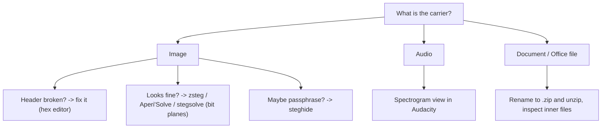

# Steganography Concepts (in order)

Learn them top to bottom. Video links are **YouTube search links** for the exact topic (no single video was verified, so none are invented). Pick a short result (3–12 min).

| # | Concept | One sentence | Why it matters in CTF | Prerequisite | Video (search) |
|---|---|---|---|---|---|
| 1 | **Carrier vs payload** | The normal file is the *carrier*; the hidden data is the *payload*. | The mental model for all of stego. | None | [search](https://www.youtube.com/results?search_query=steganography+explained+beginners) |
| 2 | **Do the forensics basics first** | `file`, `strings`, `exiftool`, `binwalk` before anything fancy. | Half of "stego" challenges are really appended data or metadata. | [Forensics](../../04-forensics/concepts/README.md) | [search](https://www.youtube.com/results?search_query=binwalk+strings+exiftool+ctf) |
| 3 | **How an image stores pixels** | Each pixel is numbers (R,G,B); the file has a header then pixel data. | You must know this before touching bits or headers. | None | [search](https://www.youtube.com/results?search_query=how+images+store+pixels+rgb+explained) |
| 4 | **File headers control display** | The first bytes tell the viewer how to read the pixels; wrong header = broken/hidden image. | The Easy challenge is exactly this. | 3 | [search](https://www.youtube.com/results?search_query=bmp+file+header+explained) |
| 5 | **Least Significant Bit (LSB)** | Changing the last bit of each colour value hides data invisibly. | The most classic image stego. | 3 | [search](https://www.youtube.com/results?search_query=LSB+steganography+explained) |
| 6 | **Bit planes** | Split an image into its 8 bit layers; hidden data shows in the lowest. | What `zsteg` and stegsolve display. | 5 | [search](https://www.youtube.com/results?search_query=bit+plane+steganography+stegsolve) |
| 7 | **Spectrogram (audio)** | A picture of sound frequencies over time; text can be "drawn" in it. | How most audio stego works. | None | [search](https://www.youtube.com/results?search_query=spectrogram+steganography+audacity+ctf) |
| 8 | **Passphrase stego (`steghide`)** | Hides a file in an image/audio, often with a password (sometimes empty). | A very common tool. | 3 | [search](https://www.youtube.com/results?search_query=steghide+tutorial+ctf) |
| 9 | **Documents are archives** | `.docx`, `.pptx`, `.xlsx` are ZIP files full of XML and media. | The Hard challenge relies on this. | None | [search](https://www.youtube.com/results?search_query=docx+is+a+zip+file+explained) |

> **الدارجة:** الفكرة: الملف العادي هو الغطاء، والسر مدسوس فيه. بدا بالأدوات البسيطة، من بعد الـ bits ديال التصويرة ولا الـ spectrogram ديال الصوت.

## Visual: the stego toolbox decision tree



## Visual: LSB in one picture

A colour value `10110100` carries a visible part (the high bits) and a hidden part (the last bit). Flip only the last bits and the eye sees no change, but the bits spell a message.

```
Pixel byte:  1 0 1 1 0 1 0 [0]   <- the [last bit] is the secret
             \___ visible ___/ \hidden/
```

Collect the last bit of each colour value, line them up, group into bytes → the hidden message.

*بالدارجة: البيت الأخير ديال كل لون ما كيبدلش التصويرة فالعين، ولكن إلا جمعتيه كامل كيعطي رسالة.*

## Important habit

Every stego challenge: **run the forensics four first.** It is embarrassing to spend an hour on bit planes when `strings` had the flag. Fancy tools are the *second* step, not the first.

## Challenge → concept map

| Challenge | Needs concepts |
|---|---|
| Easy: tunn3l v1s10n | 1–4 |
| Medium: St3g0 | 1–3, 5, 6 |
| Hard: MacroHard WeakEdge | 1, 2, 9 |

## Extra practice (optional, free)

- Audio spectrogram: search picoGym and CTF archives for audio stego; open the file in Audacity → track dropdown → **Spectrogram**.
- `steghide`: practise on any challenge that gives a `.jpg`/`.wav` and hints at a password; try an **empty** password first.
