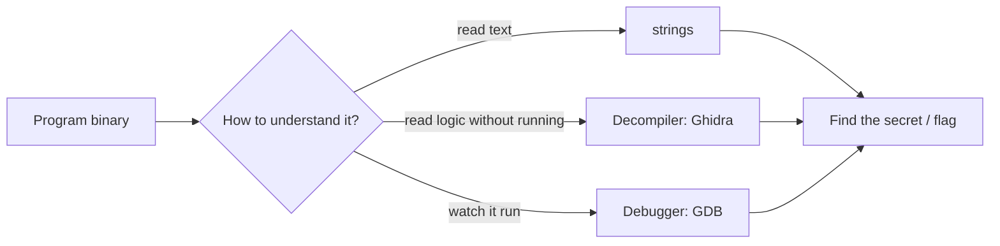
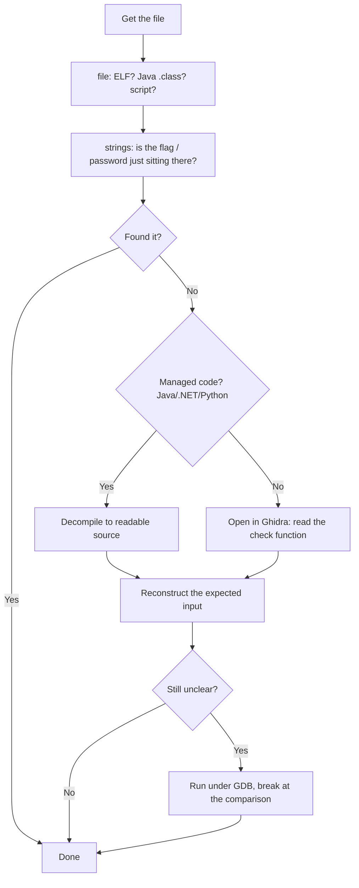
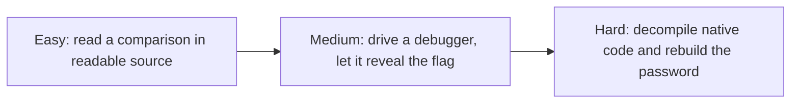

#  Reverse Engineering

-48BB78)

## A. What is this category?

**Definition:** You get a **program** but not its source code. You figure out what it does, usually to find the secret input (a password or key) it is checking for.

**Analogy:** a locked box with a keypad, but no manual. You open the box, look at the wiring, and work out which code the keypad accepts.

> **الدارجة:** عندك برنامج بلا الكود ديالو. خاصك تفهم كيفاش خدام باش تلقى الـ input السري (بحال password) اللي كيقلب عليه.

**Three ways to understand a binary** (you will use all three over time):

| Approach | What it means | Tool |
|---|---|---|
| **Static, quick** | Read the text inside without running it | `strings`, `file` |
| **Static, deep** | Read the logic as decompiled code | **Ghidra** (free) |
| **Dynamic** | Run it and watch memory/registers | **GDB** (debugger) |

## B. How do we solve these challenges?

**The routine:**

1. **`file`** — know what you are dealing with (native ELF vs Java vs script).
2. **`strings`** — the laziest win; sometimes the flag or password is right there.
3. **Decompile** — Java/.NET/Python turn back into near-source. Native code goes into **Ghidra**.
4. **Find the check** — locate where your input is compared to the secret, and read the secret (or reconstruct it).
5. **Debug if needed** — **GDB** lets you stop at the comparison and read values live.

*بالدارجة: بدا بـ `file` و`strings`. إلا ما بانش الـ flag، حلّل الكود بـ Ghidra، وإلا احتجتي، شغّل البرنامج بـ GDB وأوقفو عند المقارنة.*

## C. Concepts to learn

See the full progressive list: **[concepts/](concepts/README.md)**.

## D. Tools and environment

See **[tools/](tools/README.md)**. Short answer: a **Linux VM** (Ubuntu is fine) with `file`, `strings`, `gdb`, and **Ghidra**. Kali is **not** required.

## E. Progressive challenges

All three are **picoCTF picoGym** challenges, Reverse Engineering category. Free account. Static flags, format `picoCTF{...}`, **not** printed here.

| Level | Challenge | Platform | Link | Folder | Main tool |
|---|---|---|---|---|---|
|  | Safe Opener | picoCTF | [picoGym](https://play.picoctf.org/practice?category=3) | [open](challenges/easy/java-safe-opener/) | read source |
|  | GDB Test Drive | picoCTF | [picoGym](https://play.picoctf.org/practice?category=3) | [open](challenges/medium/gdb-test-drive/) | GDB |
|  | Classic Crackme 0x100 | picoCTF | [picoGym](https://play.picoctf.org/practice?category=3) | [open](challenges/hard/ghidra-crackme/) | Ghidra |

> Challenges are behind the picoCTF login, so there is no public per-challenge URL: open the Reverse Engineering category and search the name.

### Why these three? (learning progression)

- **Easy** (Safe Opener): the logic is **readable** (Java). You learn to find *the check* — the line that compares your input to the secret.
- **Medium** (GDB Test Drive): you meet the **debugger**. Instead of reading, you run the program under control and let it hand you the answer.
- **Hard** (Classic Crackme): native code, no friendly source. You use **Ghidra** to decompile and reconstruct the expected input character by character.

### Concept coverage table

| Concept | Easy | Medium | Hard |
|---|:---:|:---:|:---:|
| `file` and `strings` first | ✅ | ✅ | ✅ |
| Finding "the check" (comparison) | ✅ | ✅ | ✅ |
| Reading decompiled/managed source | ✅ | | ✅ |
| What a debugger is | | ✅ | |
| GDB basics: run, break, step, info | | ✅ | |
| Assembly & registers (gentle intro) | | ✅ | ✅ |
| Ghidra: import & decompile | | | ✅ |
| Reconstructing input from logic | | | ✅ |

**Not covered here (next steps):** patching a binary to bypass a check, anti-debugging tricks, stripped binaries, other languages (Go, Rust). picoGym and crackmes.one have practice for each.

## F. Quality checklist

- [x] Challenge names/categories checked against picoGym lists and public writeups (Nov 2026)
- [x] Challenges belong to Reverse Engineering; progression Easy → Hard is logical
- [x] Access stated (free picoCTF account; behind a login)
- [x] Static flags, **not reproduced** here
- [x] Videos: YouTube **search links** (see concepts)
- [x] Tool usage (GDB, Ghidra) described with standard, real commands
- [ ] ⚠️ Writeups are **source-verified**: methods match public solutions; the author did not re-download each binary

**More:** [resources.md](resources.md)
