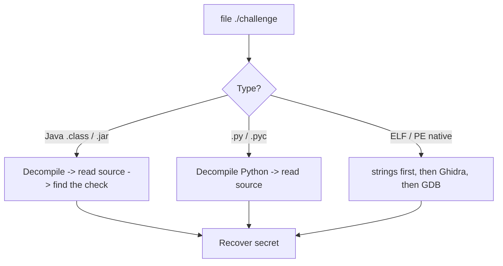
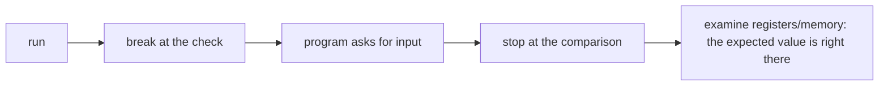

# Reverse Engineering Concepts (in order)

Learn them top to bottom. Video links are **YouTube search links** for the exact topic (no single video was verified, so none are invented). Pick a short result (3–12 min).

| # | Concept | One sentence | Why it matters in CTF | Prerequisite | Video (search) |
|---|---|---|---|---|---|
| 1 | **Source vs compiled** | Source code is human-readable; a compiled binary is machine code. | Explains why RE is needed at all. | None | [search](https://www.youtube.com/results?search_query=source+code+vs+compiled+binary+explained) |
| 2 | **`file` on a binary** | Tells you ELF (Linux), PE (Windows), Java class, or a script. | Decides which approach to use. | 1 | [search](https://www.youtube.com/results?search_query=linux+file+command+elf+explained) |
| 3 | **`strings` on a binary** | Readable text baked into the program. | The flag or password is sometimes right there. | 1 | [search](https://www.youtube.com/results?search_query=strings+command+reverse+engineering) |
| 4 | **"The check"** | The spot where your input is compared to the secret. | Finding it is 80% of easy RE. | 1 | [search](https://www.youtube.com/results?search_query=reverse+engineering+password+check+explained) |
| 5 | **Managed code decompiles cleanly** | Java/.NET/Python turn back into near-original source. | Many easy challenges are Java `.class`. | 1, 2 | [search](https://www.youtube.com/results?search_query=decompile+java+class+file) |
| 6 | **What a debugger is** | A tool to run a program step by step and inspect memory. | Lets the program reveal its own secrets. | 1 | [search](https://www.youtube.com/results?search_query=what+is+a+debugger+explained) |
| 7 | **GDB basics** | `run`, `break`, `continue`, `info registers`, `x` to examine memory. | The standard Linux debugger. | 6 | [search](https://www.youtube.com/results?search_query=gdb+tutorial+for+beginners) |
| 8 | **Assembly & registers (gentle)** | CPU instructions and small storage slots (rax, rip…). | You read a little of it in Ghidra/GDB. | 1 | [search](https://www.youtube.com/results?search_query=x86-64+assembly+registers+explained+beginners) |
| 9 | **Decompilers (Ghidra)** | Turn native machine code back into C-like pseudocode. | Makes native binaries readable. | 1, 8 | [search](https://www.youtube.com/results?search_query=ghidra+tutorial+for+beginners) |
| 10 | **Reconstructing input** | Read the logic, then compute the input that passes the check. | How you beat a crackme without brute force. | 4, 9 | [search](https://www.youtube.com/results?search_query=solve+crackme+ghidra+reconstruct+password) |

> **الدارجة:** بدا بالفرق بين الكود والبرنامج المترجم، من بعد تعلم تلقى "المقارنة" اللي كتحقق الـ input، وتعلم Ghidra و GDB بشوية بشوية.

## Visual: pick your approach by file type

## Visual: the GDB mental model

A debugger does not read the code for you; it lets you **pause time** at the interesting moment and look around.

## Important habits

- **`strings` before everything.** It is embarrassing to decompile for an hour when the flag was plain text.
- **Find the comparison.** Searching the decompiled code for `strcmp`, `==`, `equals`, or the flag prefix usually lands you on the check.
- **Work in a VM.** You are running unknown programs. Snapshot first.

*بالدارجة: ديما `strings` الأول. من بعد قلب على المقارنة (`strcmp`، `equals`). وشغّل البرامج المجهولة غير فـ VM.*

## Challenge → concept map

| Challenge | Needs concepts |
|---|---|
| Easy: Safe Opener | 1–5 |
| Medium: GDB Test Drive | 1–4, 6–8 |
| Hard: Classic Crackme 0x100 | 1–4, 8–10 |

## Extra practice (optional, free)

- picoGym Reverse Engineering: **GDB baby step 1** (first GDB register read), **vault-door** series (Java, find the check), **Transformation** (reconstruct input).
- [crackmes.one](https://crackmes.one) — a whole site of practice crackmes, filtered by difficulty.
