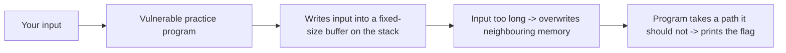
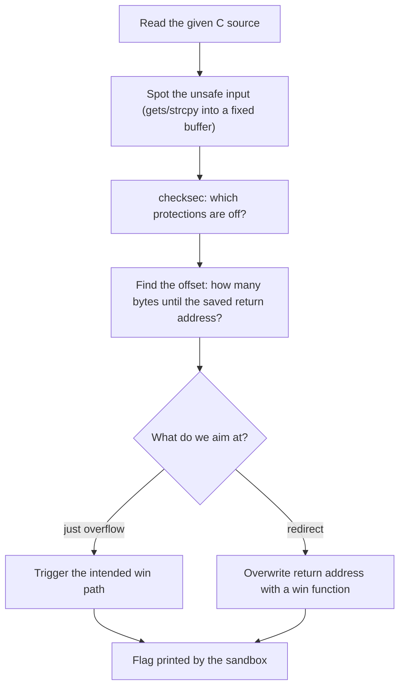
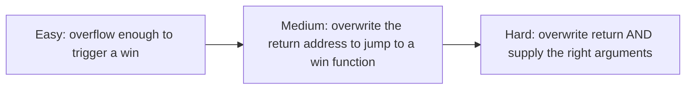

#  Binary Exploitation (Pwn)

-48BB78)

> **Scope note:** this category is strictly about **intentionally vulnerable practice binaries** provided by CTF platforms, exploited **inside their own sandbox**. The goal is to understand *why* memory bugs happen so you can write safer code and recognise them. Never apply these techniques to software or systems you are not explicitly authorised to test. See [rules and ethics](../00-getting-started/ctf-rules-and-ethics.md).

## A. What is this category?

**Definition:** You get a small program (often written in C) that has a memory bug on purpose, plus a sandbox server to connect to. You send carefully shaped input that makes the program misbehave in your favour — usually to make it print its flag.

**Analogy:** a form with a box that says "max 16 letters", but the clerk never actually checks the length. Write far past the edge and you start scribbling on the next fields of the paper. In memory, those "next fields" can control what the program does.

> **الدارجة:** عندك برنامج فيه غلطة فالذاكرة بعمد (فـ lab). كتصيفط ليه input مدروس باش يخرج عن المسار العادي ويطبع ليك الـ flag. غير فالبيئة المسموحة.

## B. How do we solve these challenges?

**The routine:**

1. **Read the source.** CTF pwn challenges usually give you the `.c` file. Find the unsafe call (`gets`, `strcpy`, `read` into a small buffer).
2. **`checksec`** — see which protections are disabled (these challenges disable them on purpose so beginners can learn).
3. **Find the offset** — how many bytes of input fill the buffer and reach the saved return address. A **cyclic pattern** finds this instantly.
4. **Build the input** — enough padding, then the value you want to place (e.g. the address of a `win()` function the challenge provides).
5. **Send it to the sandbox** with `pwntools` and read the flag.

*بالدارجة: قرا الـ C، لقا الـ input اللي بلا تحقق، حسب شحال ديال البايتات باش توصل للـ return address، وبني الـ input. كلشي فالـ sandbox ديال المنصة.*

## C. Concepts to learn

See the full progressive list: **[concepts/](concepts/README.md)**.

## D. Tools and environment

See **[tools/](tools/README.md)**. Short answer: a **Linux VM** with `gdb` (+ `pwndbg`) and Python's **`pwntools`**. Kali is **not** required.

## E. Progressive challenges

All three are **picoCTF picoGym** challenges, Binary Exploitation category — the canonical beginner overflow series. Free account. You connect to picoCTF's **own sandbox**; flags are static, format `picoCTF{...}`, **not** printed here.

| Level | Challenge | Platform | Link | Folder | New idea |
|---|---|---|---|---|---|
|  | buffer overflow 0 | picoCTF | [picoGym](https://play.picoctf.org/practice?category=6) | [open](challenges/easy/buffer-overflow-0/) | crash / trigger |
|  | buffer overflow 1 | picoCTF | [picoGym](https://play.picoctf.org/practice?category=6) | [open](challenges/medium/buffer-overflow-1/) | control the return address |
|  | buffer overflow 2 | picoCTF | [picoGym](https://play.picoctf.org/practice?category=6) | [open](challenges/hard/buffer-overflow-2/) | pass arguments too |

> Behind the picoCTF login; no public per-challenge URL. Open the Binary Exploitation category and search the name.

### Why these three? (learning progression)

Each step adds exactly one new idea on top of the previous one. This is the single best beginner progression in all of CTF pwn, which is why they are numbered 0, 1, 2.

### Concept coverage table

| Concept | Easy (0) | Medium (1) | Hard (2) |
|---|:---:|:---:|:---:|
| Reading the vulnerable C source | ✅ | ✅ | ✅ |
| The stack & a fixed-size buffer | ✅ | ✅ | ✅ |
| `checksec` / disabled protections | ✅ | ✅ | ✅ |
| Overflowing a buffer | ✅ | ✅ | ✅ |
| Finding the offset (cyclic pattern) | | ✅ | ✅ |
| The saved return address | | ✅ | ✅ |
| Redirecting to a `win`/flag function | | ✅ | ✅ |
| Placing function arguments on the stack | | | ✅ |
| Scripting with `pwntools` | (optional) | ✅ | ✅ |

**Not covered here (next steps):** shellcode, ret2libc, ROP, format-string bugs, defeating ASLR/NX/canaries. picoGym's later pwn challenges and [pwn.college](https://pwn.college) teach these in order.

## F. Quality checklist

- [x] Challenge names/categories checked against picoGym lists and public writeups (Nov 2026)
- [x] Challenges belong to Binary Exploitation; progression Easy → Hard is logical
- [x] Access stated (free picoCTF account; exploited only in picoCTF's sandbox)
- [x] Static flags, **not reproduced** here
- [x] Videos: YouTube **search links** (see concepts)
- [x] Explicit ethics scope: practice binaries, authorised sandbox only
- [ ] ⚠️ Writeups are **source-verified**: methods match public solutions; the author did not re-run each exploit

**More:** [resources.md](resources.md)
