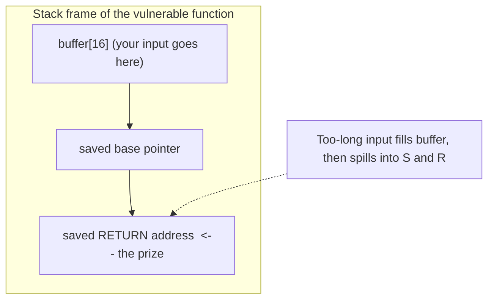
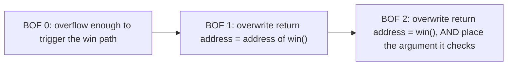

# Binary Exploitation Concepts (in order)

Learn them top to bottom. These challenges are about **understanding memory bugs** so you can recognise and prevent them. Video links are **YouTube search links** (no single video verified). Pick a short result.

| # | Concept | One sentence | Why it matters | Prerequisite | Video (search) |
|---|---|---|---|---|---|
| 1 | **Memory & the stack** | Local variables live on a region called the stack, which grows and shrinks per function call. | Everything here happens on the stack. | None | [search](https://www.youtube.com/results?search_query=program+stack+memory+explained+beginners) |
| 2 | **Buffers** | A buffer is a fixed-size box for data (e.g. `char name[16]`). | Overflowing one is the whole category. | 1 | [search](https://www.youtube.com/results?search_query=what+is+a+buffer+in+c+explained) |
| 3 | **Unsafe input functions** | `gets`, `strcpy`, unbounded `read` copy input with **no length check**. | They are the bug. | 2 | [search](https://www.youtube.com/results?search_query=gets+strcpy+unsafe+c+buffer+overflow) |
| 4 | **Buffer overflow** | Writing past a buffer's end overwrites neighbouring memory. | The core vulnerability. | 2, 3 | [search](https://www.youtube.com/results?search_query=buffer+overflow+explained+simply) |
| 5 | **The saved return address** | The stack stores where to go back to when a function ends. | Overwrite it and you redirect the program. | 1, 4 | [search](https://www.youtube.com/results?search_query=stack+return+address+buffer+overflow+explained) |
| 6 | **Finding the offset** | The exact number of bytes from the buffer to the return address. | You need it to aim precisely. | 4, 5 | [search](https://www.youtube.com/results?search_query=cyclic+pattern+offset+buffer+overflow+pwntools) |
| 7 | **`checksec` & protections** | Modern binaries have canaries, NX, PIE, ASLR; practice ones disable them. | Tells you how hard the challenge is. | 1 | [search](https://www.youtube.com/results?search_query=checksec+canary+nx+pie+aslr+explained) |
| 8 | **A `win` function** | Challenges include a function that prints the flag if reached. | Your target address. | 5 | [search](https://www.youtube.com/results?search_query=ret2win+buffer+overflow+explained) |
| 9 | **Endianness & addresses** | x86 stores addresses little-endian; `pwntools` `p32`/`p64` pack them. | So the address lands correctly. | 5 | [search](https://www.youtube.com/results?search_query=little+endian+address+packing+pwntools) |
| 10 | **`pwntools`** | A Python library to connect, send bytes, and pack addresses. | The standard exploit-scripting tool. | 1–9 | [search](https://www.youtube.com/results?search_query=pwntools+tutorial+beginners) |

> **الدارجة:** الفكرة: الـ buffer صندوق محدود. إلا كتبتي أكثر من حجمو، كتمسح الذاكرة اللي حداه، بما فيها العنوان اللي كيرجع ليه البرنامج. إلا تحكمتي فهاد العنوان، تقدر توجّه البرنامج لـ function اللي كتطبع الـ flag.

## Visual: the stack and an overflow

Fill the buffer, keep writing, and your bytes reach the **return address**. Replace it with the address of a `win` function and the program "returns" into that function.

## Visual: the three steps of this category

## Why we study this (defence)

Understanding overflows teaches you to **write safe code**: use bounded functions (`fgets` instead of `gets`), check lengths, and keep compiler protections on. Every exploit here is only possible because a protection was deliberately turned off for learning.

*بالدارجة: هاد الشي كنتعلموه باش نكتبو كود آمن ونعرفو كيفاش نحميو منو، ماشي باش نهاجمو ناس.*

## Challenge → concept map

| Challenge | Needs concepts |
|---|---|
| Easy: buffer overflow 0 | 1–4, 7 |
| Medium: buffer overflow 1 | 1–10 |
| Hard: buffer overflow 2 | 1–10 (+ argument placement) |

## Extra practice (optional, free)

- [pwn.college](https://pwn.college) — a free, structured university-style course on binary exploitation, in order.
- picoGym Binary Exploitation: continue to **x-sixty-what** and the later overflow challenges.
