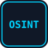
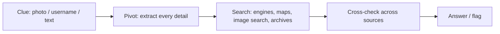
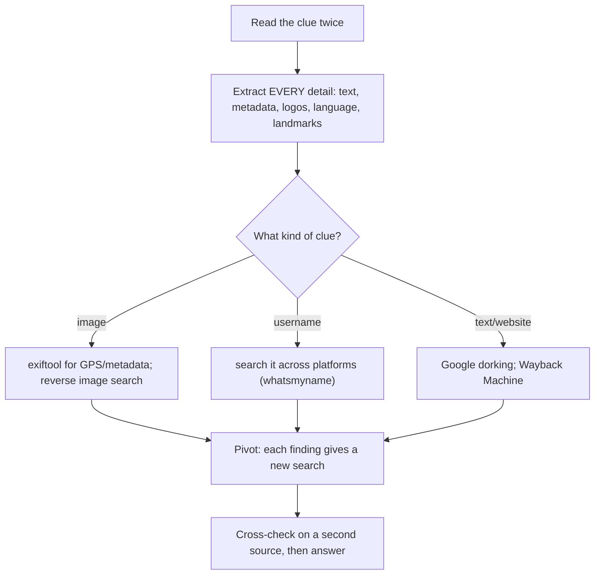
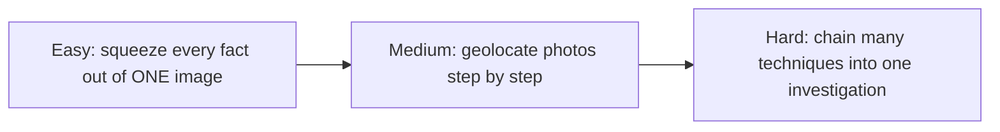

#  OSINT

-48BB78)

> **Ethics first:** OSINT = Open Source INTelligence, finding answers in **public** information. In CTF you investigate **challenge-provided targets only** (a given image, a fictional username, a scenario). Never profile, locate, or track a **real private person**. See [rules and ethics](../00-getting-started/ctf-rules-and-ethics.md).

## A. What is this category?

**Definition:** you are given a small clue — a photo, a username, a short story — and you find a fact about it using only publicly available information: search engines, maps, image search, public profiles, archives.

**Analogy:** a detective with one photograph. From a street sign, the shadows, and a shopfront, they work out the city, then the exact corner — using only public tools.

> **الدارجة:** كتعطاك شي إشارة صغيرة (تصويرة، username، قصة) وكتلقى المعلومة بأدوات عامة: محركات البحث، الخرائط، البحث بالصورة. غير على الأهداف ديال التحدي، ماشي على ناس حقيقيين.

## B. How do we solve these challenges?

**The routine:**

1. **Extract everything** from the clue before searching — small details (a sign, a language, a logo) are the pivots.
2. **Match the tool to the clue:** image → `exiftool` + reverse image search; username → cross-platform search; website/text → Google dorking + archives.
3. **Pivot:** every fact you find feeds the next search.
4. **Cross-check** on a second independent source before trusting an answer.

*بالدارجة: خرّج كل تفصيل من الإشارة الأول. كل معلومة كتعطيك بحث جديد. وأكّد ديما على مصدر ثاني.*

## C. Concepts to learn

See the full progressive list: **[concepts/](concepts/README.md)**.

## D. Tools and environment

See **[tools/](tools/README.md)**. Short answer: **a browser is enough** for almost all OSINT. Add `exiftool` for image metadata. No Kali, no VM required.

## E. Progressive challenges

All three are free **TryHackMe** rooms (free account). TryHackMe uses dynamic, per-account answers, so there is no universal flag to leak — this repo teaches the method.

| Level | Room | Platform | Link | Folder | Focus |
|---|---|---|---|---|---|
|  | OhSINT | TryHackMe | [room](https://tryhackme.com/room/ohsint) | [open](challenges/easy/ohsint/) | one image → everything |
|  | Searchlight - IMINT | TryHackMe | [room](https://tryhackme.com/room/searchlightosint) | [open](challenges/medium/searchlight-imint/) | image & geolocation |
|  | Sakura Room | TryHackMe | [room](https://tryhackme.com/room/sakura) | [open](challenges/hard/sakura-room/) | full multi-pivot investigation |

> Free TryHackMe account required. Rooms run in the browser. Answers are entered in the room, not as a `picoCTF{}`-style flag.

### Why these three? (learning progression)

- **Easy** (OhSINT): one picture, many answers. You learn to extract metadata and pivot to public profiles.
- **Medium** (Searchlight IMINT): structured **image intelligence** and **geolocation** — reverse image search, landmarks, street view.
- **Hard** (Sakura Room): a full case that **chains** username enumeration, metadata, geolocation, and more — you choose the right tool at each step.

### Concept coverage table

| Concept | Easy | Medium | Hard |
|---|:---:|:---:|:---:|
| Extract every detail from a clue | ✅ | ✅ | ✅ |
| Image metadata (`exiftool`, GPS) | ✅ | ✅ | ✅ |
| Reverse image search | | ✅ | ✅ |
| Geolocation (landmarks, street view) | | ✅ | ✅ |
| Username enumeration across platforms | ✅ | | ✅ |
| Google dorking (`site:`, `filetype:`) | | | ✅ |
| Wayback Machine / archives | | | ✅ |
| Pivoting & cross-checking sources | ✅ | ✅ | ✅ |

**Not covered here (next steps):** DNS/WHOIS recon, social-media timeline analysis, EXIF-stripping awareness, Shodan for devices. TryHackMe's *Google Dorking*, *Web OSINT*, and *Shodan* rooms continue the path.

## F. Quality checklist

- [x] Rooms exist and are free; names/URLs checked (Nov 2026)
- [x] Rooms belong to OSINT; progression Easy → Hard is logical
- [x] Access stated (free TryHackMe account; browser-based)
- [x] No fabricated answers/flags (TryHackMe answers are per-account anyway)
- [x] Videos: YouTube **search links** (see concepts)
- [x] Explicit ethics scope: challenge targets only, never real private people
- [ ] ⚠️ Writeups are **method guides** (source-verified against public room descriptions); exact answers are left for you to find

**More:** [resources.md](resources.md)
