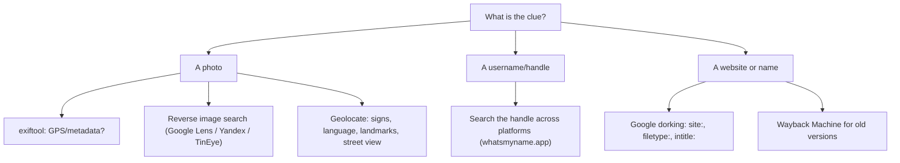
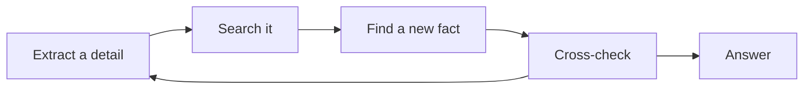

# OSINT Concepts (in order)

Learn them top to bottom. Video links are **YouTube search links** for the exact topic (no single video was verified). Pick a short result (3–12 min).

| # | Concept | One sentence | Why it matters in CTF | Prerequisite | Video (search) |
|---|---|---|---|---|---|
| 1 | **What OSINT is (and its ethics)** | Finding answers from public info; in CTF, only on provided targets. | Keeps you legal and focused. | None | [search](https://www.youtube.com/results?search_query=what+is+osint+explained+ethics) |
| 2 | **Extract every detail** | Before searching, list every clue: text, logo, language, shadow, sign. | Each detail is a pivot. | 1 | [search](https://www.youtube.com/results?search_query=osint+image+analysis+clues+beginners) |
| 3 | **Image metadata (EXIF)** | Photos can store GPS, time, camera, author. | Sometimes the answer is in the file itself. | 1 | [search](https://www.youtube.com/results?search_query=exif+gps+metadata+photo+osint) |
| 4 | **Reverse image search** | Upload a picture to find where else it appears / what it shows. | Finds locations, people's public posts, sources. | 2 | [search](https://www.youtube.com/results?search_query=reverse+image+search+google+lens+yandex+tutorial) |
| 5 | **Geolocation** | Pin a photo's place from landmarks, signs, and street view. | The core of image-intelligence challenges. | 2, 4 | [search](https://www.youtube.com/results?search_query=photo+geolocation+osint+street+view+tutorial) |
| 6 | **Username enumeration** | The same handle often exists on many platforms. | One username → many public profiles. | 1 | [search](https://www.youtube.com/results?search_query=username+enumeration+osint+whatsmyname) |
| 7 | **Google dorking** | Advanced search operators: `site:`, `filetype:`, `intitle:`, `inurl:`. | Finds exposed files and pages fast. | 1 | [search](https://www.youtube.com/results?search_query=google+dorking+tutorial+beginners) |
| 8 | **Archives (Wayback Machine)** | See old versions of a web page. | Recovers deleted/changed info. | 1 | [search](https://www.youtube.com/results?search_query=wayback+machine+osint+tutorial) |
| 9 | **Pivoting & cross-checking** | Each finding fuels the next search; confirm on a second source. | Avoids wrong answers and dead ends. | all | [search](https://www.youtube.com/results?search_query=osint+pivoting+methodology) |

> **الدارجة:** الأخلاق قبل كلشي: غير على الأهداف ديال التحدي. خرّج كل تفصيل، استعمل الأداة المناسبة (metadata، reverse image، dorking)، وأكّد على مصدر ثاني.

## Visual: tool for each clue

## Visual: the OSINT loop

OSINT is rarely one search. It is a **loop**: each fact you uncover becomes the seed of the next search, until a cross-checked answer appears.

## The ethics line (read this)

- **Do:** investigate the image, username, or scenario the challenge gives you.
- **Do not:** use these skills to find, track, or build a profile of a **real private individual**, in or out of a CTF.
- Public-figure/company scenarios in rooms are designed and consented for training. Real people are not.

*بالدارجة: المهارات هادي قوية. استعملها غير فالتحديات، وما تستعملهاش باش تقلب على ناس حقيقيين. هاد الشي خطير وممنوع.*

## Challenge → concept map

| Challenge | Needs concepts |
|---|---|
| Easy: OhSINT | 1–4, 6, 9 |
| Medium: Searchlight IMINT | 1–5, 9 |
| Hard: Sakura Room | 1–9 |

## Extra practice (optional, free)

- TryHackMe: **Google Dorking**, **Web OSINT**, **Shodan** rooms.
- [GeoGuessr](https://www.geoguessr.com) to sharpen geolocation instincts (free games available).
