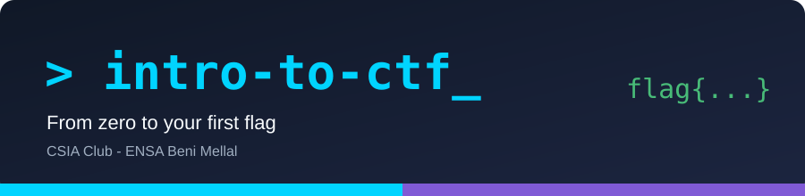
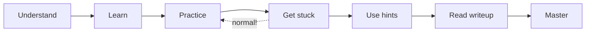

  

# Introduction to CTF

A beginner-friendly learning path for your **first Capture The Flag** competitions, built by the **CSIA** (cybersecurity & AI) club at **ENSA Béni Mellal**.

> **بالدارجة:** هاد الـ repository كيعلمك كيفاش تفكر وكيفاش تحل تحديات الـ CTF، من الصفر حتى تولي كتحل تحديات بوحدك.

---

## Learning philosophy

Getting stuck is **part of the method**, not a failure.
*بالدارجة: التعطل عادي، هو جزء من التعلم.*

---

## Navigation

| # | Section | What you learn | Status |
|---|---|---|---|
| 00 | [Getting Started](00-getting-started/) | What CTF is, rules, platforms, setup | ✅ Done |
| 01 | [Linux Cheat Sheet](01-linux-cheatsheet/) | Commands you will use every day | ✅ Done |
| 02 | [Web Exploitation](02-web-exploitation/) | HTTP, hidden pages, SQL injection | ✅ Done (see [verification notes](#honesty-and-verification)) |
| 03 | [Cryptography](03-cryptography/) | Encoding, XOR, RSA basics | ✅ Done |
| 04 | [Forensics](04-forensics/) | Files, metadata, network captures | ✅ Done |
| 05 | [Steganography](05-steganography/) | Data hidden in images, audio, docs | ✅ Done |
| 06 | [Reverse Engineering](06-reverse-engineering/) | Understanding programs without source | ✅ Done |
| 07 | [Binary Exploitation](07-binary-exploitation/) | Memory bugs in programs (sandboxed) | ✅ Done |
| 08 | [OSINT](08-osint/) | Finding answers in public information | ✅ Done |
| — | [Resources](resources/) | Platforms, videos, glossary | ✅ Done |
| — | [Interactive roadmap](docs/index.html) | A dark-mode page you can host on GitHub Pages | ✅ Done |

---

## Challenges at a glance

Every category has exactly **three real challenges** (easy → medium → hard) on free, public platforms, each with hints and a full writeup.

| Category | Platform | Easy → Medium → Hard |
|---|---|---|
| Web Exploitation | PortSwigger | Unprotected admin → SQLi login bypass → SQLi UNION |
| Cryptography | CryptoHack | Encoding → single-byte XOR → RSA Starter |
| Forensics | picoCTF | Glory of the Garden → So Meta → Wireshark doo dooo do doo |
| Steganography | picoCTF | tunn3l v1s10n → St3g0 → MacroHard WeakEdge |
| Reverse Engineering | picoCTF | Safe Opener → GDB Test Drive → Classic Crackme 0x100 |
| Binary Exploitation | picoCTF | buffer overflow 0 → 1 → 2 |
| OSINT | TryHackMe | OhSINT → Searchlight IMINT → Sakura Room |

All platforms are free (some need a free account). No flags, outputs, or solutions are fabricated — see [Honesty and verification](#honesty-and-verification).

## How to use this repository

1. Read [`00-getting-started`](00-getting-started/what-is-ctf.md) first (20 minutes).
2. Set up your tools: [`setup-your-environment.md`](00-getting-started/setup-your-environment.md).
3. Skim the [Linux cheat sheet](01-linux-cheatsheet/README.md). Keep it open while you practice.
4. Pick a category. Follow its folder in order: **concepts → tools → easy → medium → hard**.
5. For every challenge: **try alone → read hints one by one → read the writeup last**.

## Difficulty badges

  

## Honesty and verification

- Every challenge links to a **real, public platform page**. Nothing is invented.
- Writeups are labelled with a **verification status**. Read the label at the top of each writeup.
- We **link** to third-party challenges. We do not copy their files or flags.
- Found a mistake? Open an issue. See [CONTRIBUTING.md](CONTRIBUTING.md).

## Legal and ethical note

Only practice on platforms and labs that **allow** it. Never test real websites or systems without written permission. Read [CTF rules and ethics](00-getting-started/ctf-rules-and-ethics.md).

---

Made for students of ENSA Béni Mellal. Third-party challenge content belongs to its owners. Code and docs here are MIT licensed.
